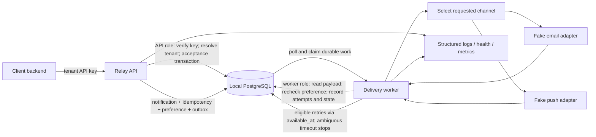

# Relay Notification Platform — System Design

**Version:** 0.1  
**Status:** Design approved for the initial local prototype; application implementation has not started. The approved stack and decisions below govern the first implementation slice.
**Scale from brief:** 50 million notifications/day  
**Working peak assumption:** 10× average  
**Prototype channels:** Email and push  
**Provider model:** Fake providers with configurable, deterministic test outcomes
**Authoritative database:** PostgreSQL. The initial prototype uses a local PostgreSQL instance; Neon is a possible future hosted PostgreSQL option and is not connected for the initial prototype.

> Keep estimates, proposed targets, and public list prices clearly distinguished from measured results. Do not fill in load-test or failure-drill outcomes until evidence is collected.

## Proposed service responsibilities

- **PostgreSQL is the authoritative database for all Relay business data.** The initial prototype uses local PostgreSQL for tenants, tenant API-key hashes and status, preferences, notifications, idempotency records, delivery attempts, and outbox work. Neon may host this PostgreSQL database in a later, separately approved deployment; it is not used by the initial prototype. There must not be a second notification-data store.
- **Supabase Auth is deferred and is not a prototype runtime dependency.** It is not necessary for machine-to-machine tenant API-key authentication. It may be reconsidered if a human-facing admin interface needs user sign-in. Supabase PostgreSQL will not hold or replicate Relay notification data.
- The API authenticates each tenant backend with a separate, randomly generated high-entropy API key. PostgreSQL stores only a SHA-256 digest of the secret and key metadata; the verified key record determines the tenant. Keys must be revocable and rotatable, and must never appear in logs.
- No real email or push provider is part of the prototype. Both channels use fake providers with deterministic outcomes for tests.

These are design recommendations, not service configuration. The user creates accounts and performs any approved dashboard setup. No credentials should be pasted into chat or committed.

## 1. Requirements

### 1.1 Functional requirements
See `PRD.md` FR-01 through FR-12. Summarise the critical path here: authenticate and validate request; apply idempotency; persist accepted work; check preferences; enqueue eligible channel work; deliver asynchronously; record attempt outcomes; retry transient failures; expose state and operational signals.

### 1.2 Non-functional requirements
See `PRD.md` NFR-01 through NFR-08. Include capacity, reliability, duplicate resistance, scalability, security, observability, cost awareness, and testability.

### 1.3 Out of scope
Real production provider integrations, complete commercial operations, full customer analytics, billing, and an end-to-end exactly-once guarantee across external providers and recipient devices.

### 1.4 Approved decisions and remaining questions
- **Approved stack and architecture:** the initial local prototype uses Node.js LTS, TypeScript, npm, Fastify, `pg`, `node-pg-migrate`, and Vitest. PostgreSQL is authoritative and the prototype uses its transactional outbox. No ORM, separate broker, real provider, or Neon connection is required for the initial local prototype. Neon remains the proposed later host for PostgreSQL; Supabase Auth is deferred.
- **Approved authentication direction:** authenticate each tenant backend with a separately issued API key whose hash is stored in PostgreSQL. A tenant API key is distinct from the fingerprint HMAC secret and the client idempotency key.
- **Finalized content scope:** the prototype accepts rendered notification content only: email subject + plain-text body, or push title + plain-text body. Templates, template variables, HTML email, and attachments are out of scope. This scope is reflected in the API validation rules and does not create a requirement for Relay-managed template rendering.
- **Finalized idempotency decisions:** store raw client idempotency keys in a dedicated reservation table for deduplication only, with tenant-scoped uniqueness; never use them for authentication or expose them in logs/responses/analytics. Normalize only the specified user-visible content fields to NFC, preserve decoded recipient IDs exactly, and fingerprint the custom versioned tagged binary representation with a dedicated versioned HMAC-SHA-256 key. Approved tags/order: channel `0x01`, recipient ID `0x02`, then email subject/body `0x10`/`0x11` or push title/body `0x20`/`0x21`.
- **Approved idempotency-key policy:** accept only ASCII bytes `0x21` through `0x7E` inclusive, with a total length of 1–128 bytes. Reject every other byte before opening the acceptance transaction. Never trim, normalize, or otherwise transform the supplied key.
- **Finalized channel scope:** exactly one supported channel (`email` or `push`) per request. A client needing both submits two independent requests with distinct idempotency keys. Relay does not create parent/child notifications or fan out channels in the prototype. Multi-channel fan-out is a future enhancement.
- The approved API-key lifecycle is detailed in Section 3. Open details are the public key ID syntax/length, encoding/validation of the 32-byte secret, and threshold for treating a key as unused.
- What human review action, if any, should be available for `delivery_unknown`? No automatic replay is proposed.
- **Approved reservation and concurrency decisions:** use the dedicated reservation schema and tenant-scoped uniqueness described in Sections 4 and 6.1; resolve a uniqueness loser only after rolling back candidate work, then read the winner under PostgreSQL `READ COMMITTED`. A reservation is not deleted while its operation is active; expiry alone does not authorize deletion.
- **Approved preference policy:** preferences are explicit opt-in. No preference row and an explicit `enabled = false` both suppress delivery. Record the suppression outcome in the acceptance transaction and create no eligible outbox event.
- **Approved database development defaults:** 5-second lock timeout, 5-second statement timeout, at most 3 total attempts for explicitly classified retryable transaction failures, with deterministic 100 ms and 250 ms waits between attempts. These are local development defaults, not production SLOs. Provider-delivery retry limits and delays are separate.
- **Approved fingerprint-secret configuration:** configure the dedicated `RELAY_FINGERPRINT_HMAC_KEY` through the environment with a positive `RELAY_FINGERPRINT_HMAC_KEY_VERSION`; keep the secret distinct from tenant API keys and idempotency keys. Retain older versioned secrets for every live reservation that still needs them.
- **Remaining operational questions:** exact database grants and owner-run key-management workflow; human review procedure for `delivery_unknown`; final error-response schema and rate-limit policy; HMAC secret generation/encoding procedure; public API-key ID syntax, secret text encoding, and unused-key threshold; Neon region and backup/history terms. These do not change the approved initial local acceptance design.
- **Provisional future-hosting region decision:** Europe for the expected Nigerian test audience, subject to checking Neon availability and measuring latency if Neon is selected for a separately approved hosted deployment. For the rough cost scenario, “100,000 users” is defined as 100,000 registered active recipients, each receiving one notification per day.
- Which small always-on compute provider, if any, should be selected after verifying regional availability, orderability, final prices, and operational requirements? Section 12 compares public prices, but no provider is selected or provisioned.

## 2. Back-of-envelope estimates

### 2.1 Throughput
Daily volume = 50,000,000 logical notifications.  
Seconds/day = 24 × 60 × 60 = 86,400.  
Average = 50,000,000 / 86,400 ≈ **579 notifications/second**.  
Initial 10× peak = 579 × 10 ≈ **5,790 notifications/second** (approximately 5,787 using the unrounded average).

This is a planning assumption, not a measured workload. Each logical request has one channel; retries and delivery-attempt records create additional work. A client broadcast or a request for both channels is represented by multiple independent API requests, not Relay-managed fan-out.

### 2.2 Storage
Working assumption: 1 KB per logical notification record before indexes, replication, backups, and attempt records.  
Daily raw storage ≈ 50,000,000 × 1 KB = **50 GB/day**.  
Annual raw storage ≈ 50 GB × 365 = **18.25 TB/year**.

This is simplified gross storage before applying the proposed retention windows. Actual retained storage cannot be estimated until payload size, attempt volume, indexes, and cleanup behavior are measured. These numbers are not a database-size or provider-capacity claim.

### 2.3 Bandwidth
Working assumption: 2 KB per outbound payload, excluding protocol overhead.  
Daily payload ≈ 100 GB/day.  
Average payload bandwidth ≈ 100 GB × 8 / 86,400 ≈ **9.3 Mbps**.  
10× peak payload bandwidth ≈ **92.6 Mbps**.

Actual traffic will be higher due to protocol overhead, provider responses, retries, and internal traffic.

### 2.4 Implications
Accept work quickly, persist it durably, and process asynchronously. Track queue depth and oldest-message age so a growing backlog is visible. Load-test outcomes must be measured and reported, not inferred from these estimates.

### 2.5 Proposed prototype objectives (not measured)

- **Region:** For a future hosted deployment, Europe is provisional because the expected test users are in Nigeria. This is not verified as latency-optimal. If Neon is later selected after separate approval, the user will check available regions and measure latency; keep the API and worker close to the selected database region. The local prototype has no hosted region. Do not introduce multi-region infrastructure.
- **API acceptance latency:** target p95 ≤ 500 ms and p99 ≤ 1 second under a clearly documented test workload, excluding asynchronous provider delivery.
- **Durability:** 100% of responses returning `202 Accepted` must follow a successfully committed PostgreSQL transaction.
- **Preference suppression:** notifications blocked by the requested channel preference must be durably recorded as `suppressed`.
- **Availability:** do not claim 24/7 availability or production-grade uptime for the graduation prototype.

Latency objectives are goals, not achieved results. Before reporting them, document the workload, environment/region, measurement method, results, and limitations. No test has measured these targets yet.

## 3. API design

**Status: approved prototype contract; implementation details follow the approved stack above.**

### Authentication and tenant scope

**User-approved design decision:** tenant keys use the format `relay_live_<public-key-id>.<secret>`. Generate 32 secret bytes using a cryptographically secure random generator. Store the non-secret public key ID, tenant association, lifecycle metadata, and SHA-256 digest of the secret; never store the plaintext key. SHA-256 is suitable for these uniformly random, high-entropy secrets, not for human-chosen passwords.

At request time, use the public ID to look up one key record, compute SHA-256 of the supplied secret, and compare the digest with a constant-time comparison. Authenticate only if the key record is active and not revoked; derive tenant scope only from that record. Never treat a caller-supplied tenant ID as authorization. Missing, malformed, unknown-ID, incorrect-secret, and revoked-key failures all receive the same generic `401 Unauthorized`; do not disclose whether a public ID exists. Constant-time comparison reduces one timing signal but cannot eliminate timing differences across the full request and database path.

**User-approved lifecycle:** an owner-run local issuance command generates a key and displays it exactly once in an interactive terminal, only after the database confirms that the hash record committed. If commit cannot be confirmed, do not display the secret. The owner copies it directly into the tenant client's local secret store. Never write plaintext keys to files, shell history, application/access/error logs, or chat. A lost key cannot be recovered; revoke it and issue a replacement. Terminal capture or screen exposure remains a risk.

Planned rotation permits at most two valid keys for a tenant: the current key and one replacement. The superseded key is rejected automatically after a 24-hour overlap. A further rotation revokes any older overlap key and starts a new 24-hour window for the most recently superseded key. Emergency revocation is immediate. Keys do not otherwise expire automatically. Review active keys every 90 days for ownership, continued need, last-used time, and planned rotation. Immediately revoke keys that are unowned, no longer needed, meet the unused-key criteria, or are suspected exposed. **Open:** define the threshold for an “unused” key; do not infer one from `last_used_at`.

**Logging and error policy:** apply an explicit allowlist and redaction before application, HTTP access, and error logging. Never log request/response bodies; credential or authorization headers; cookies; raw API keys or public key IDs; idempotency-key values; recipient IDs; notification content or template data; SQL parameters; or raw exception payloads. Return sanitized errors that do not echo caller input or internal database/provider details. Permitted operational fields are limited to necessary values such as request correlation ID, route template without query parameters, status code, duration, and coarse outcome category. The reduced detail makes debugging harder and may require synthetic reproductions; a future component could bypass the policy.

Automated tests should use synthetic credentials/fixtures and must not require real tenant keys, Neon credentials, or Supabase. Supabase Auth is not configured or called by the prototype API.

### Proposed endpoints

| Endpoint | Purpose and proposed behavior |
|---|---|
| `POST /v1/notifications` | Authenticated with a tenant API key; validates recipient, exactly one supported channel (`email` or `push`), channel-specific rendered plain-text content, and the `Idempotency-Key` header. Returns `202 Accepted` only after the notification, dedicated idempotency reservation, preference decision, and any eligible outbox work are durably committed. Preferences are explicit opt-in: a missing preference row or `enabled = false` is recorded as `suppressed`, with no eligible outbox event. Idempotency is scoped to tenant + key: a repeated key with the same request returns that notification's stable identifier and current status; the same key with a different request returns `409 Conflict`. Repeating a request in `delivery_unknown` returns that same unknown notification rather than silently initiating another send. A request for both channels requires two calls with distinct keys and creates two independent notifications. The raw idempotency key is never returned. |
| `GET /v1/notifications/{notificationId}` | Returns permitted status/metadata only when the notification belongs to the authenticated tenant. Never returns content. Return a non-disclosing not-found response for unknown or other-tenant IDs. |
| `GET /v1/preferences/{recipientId}` | Reads preferences only for the authenticated tenant. |
| `PUT /v1/preferences/{recipientId}` | Creates or updates that tenant's recipient/channel preference after validating allowed channels and values. |

The preference endpoints are the selected way to make FR-04 testable through the API. Missing preference rows and explicit disabled preferences both suppress delivery. A worker selects exactly one adapter from the notification's validated channel. There is no API-level multi-channel fan-out in the prototype.

### Approved contract details and remaining API questions

- **User-approved payload:** store rendered content only; do not store templates or template variables. Email accepts `subject` and plain-text `body`; push accepts `title` and plain-text `body`. HTML and attachments are out of prototype scope. Use synthetic recipient IDs and synthetic content in every test; never use real recipient data. Content is not returned by status endpoints and is never logged or echoed in errors.
- Enforce a maximum raw JSON request body of 65,536 bytes (64 KiB) before persisting or queueing. Validate `recipient_id` at no more than 256 UTF-8 bytes and `Idempotency-Key` at 1–128 UTF-8 bytes. Measure byte lengths, not character counts.
- Require exactly one `Idempotency-Key` header. Accept only ASCII bytes `0x21` through `0x7E` inclusive and a total length of 1–128 bytes. Reject all other bytes, a missing or duplicate header, or a key outside that length with `400 invalid_idempotency_key`. Do not trim, normalize, or silently transform the key. Reject a recipient ID over 256 UTF-8 bytes or malformed request with `400`; reject a body over 65,536 bytes with `413 Payload Too Large`. Reject before persistence or outbox creation; do not partially accept or queue invalid requests.
- **Approved raw-key policy:** store the validated client key only in a dedicated idempotency reservation table, for deduplication only; it is never an authentication credential. Never expose it in application/access logs, analytics, error messages, or ordinary API responses. Restrict database access according to least privilege. The exact accepted key alphabet is bytes `0x21–0x7E`, length 1–128 bytes, with no trimming or transformation.
- **Approved content normalization and fingerprint algorithm:** after JSON decoding and validation, NFC-normalize only email `subject`/`body` and push `title`/`body`; store those normalized values and use the same values in the fingerprint. Preserve content whitespace and letter casing: do not trim or lowercase. Reject required content fields that are absent, `null`, empty, or whitespace-only; do not trim or store rejected values. Preserve `recipient_id` exactly as decoded: do not NFC-normalize, lowercase, or trim it. JSON property order does not affect the canonical content.
- Build canonical bytes using the approved custom versioned tagged binary format, not canonical JSON. Start with UTF-8 bytes for `relay-notification-v1`, followed by one zero byte. Then encode each field in fixed order as a one-byte field tag, a four-byte unsigned big-endian length counting the value's UTF-8 bytes, and the UTF-8 value. Approved tags/order: channel `0x01`, recipient ID `0x02`, then email subject `0x10` and email body `0x11`, or push title `0x20` and push body `0x21`. JSON property order does not affect the canonical representation.
- Compute the fingerprint with the dedicated `RELAY_FINGERPRINT_HMAC_KEY` environment secret and its positive `RELAY_FINGERPRINT_HMAC_KEY_VERSION`. Never use a tenant API key or the client-supplied idempotency key as the HMAC secret. Store the 32-byte fingerprint as binary data. Record the HMAC key version with each reservation and retain every version needed to verify reservations for their complete retention period, including any active-operation hold. During rotation, the current secret is supplied through `RELAY_FINGERPRINT_HMAC_KEY`; prior secrets remain available as `RELAY_FINGERPRINT_HMAC_KEY_V<version>` until no retained reservation needs them. Replay uses the reservation's recorded version; new reservations use the active version. The canonical-format version (the `v1` prefix) identifies serialization semantics; the HMAC key version selects a secret. They are separate versioning concerns. Future fingerprint formats require an explicit compatibility plan and must not change v1. HMAC is a keyed digest, not encryption, and does not protect notification content stored in PostgreSQL. Generate and store real secrets outside source control and never paste them into chat.
- The canonical content includes the validated recipient ID, the single channel, and the applicable normalized rendered content fields. Exclude tenant identity (enforced by reservation uniqueness scope), API credentials, the raw idempotency key, correlation IDs, timestamps, HTTP headers, and transport-only metadata. Do not silently change v1 serialization or normalization; any future fingerprint-semantic change needs an explicit version and compatibility strategy.
- Store the HMAC result as 32-byte binary data and track canonical-format version separately from HMAC-key version. During replay/concurrency resolution, use the key version recorded on the winning reservation. Retain old HMAC-key versions while any reservation still requires verification. The reservation stores `fingerprint_format_version` and `hmac_key_version` separately; future format transitions require a separate compatibility decision.
- Proposed responses: `400` invalid request/key/recipient; generic `401 Unauthorized` for missing, malformed, unknown-ID, incorrect-secret, or revoked API key; `403` authenticated key not permitted for the operation; `404` unknown or out-of-tenant resource; `409` idempotency key reused with a different request; `413` request body too large; `429` rate limited; `5xx` server/dependency failure. Error bodies must be sanitized and must not echo caller input or internal database/provider details. Final error body and rate-limit policy remain to be specified.
- Notification states are `accepted`, `queued`, `processing`, `retry_scheduled`, `sent`, `suppressed`, `failed`, and `delivery_unknown`. `sent` means the fake provider accepted the attempt; it does not prove a recipient device displayed it. `sent`, `suppressed`, `failed`, and `delivery_unknown` are terminal for automatic processing; `delivery_unknown` requires review and does not mean known failure.
- `retry_scheduled` is the precise stored state corresponding to the PRD's example state `retrying`: the next attempt has been durably scheduled for a future time.
- A notification has exactly one channel and one independent lifecycle. No parent/child records, aggregate multi-channel status, or Relay channel fan-out is in prototype scope. Multi-channel requests are a future enhancement.

The API-key format, generation, storage, verification, one-time handoff, planned rotation overlap, revocation, review cadence, and generic authentication failure behavior above are approved design decisions. The unused-key threshold, final error-body schema, and rate-limit policy remain open operational/API details; they do not change the initial acceptance transaction contract.

### Proposed environment-variable plan

These are the approved initial runtime configuration names. The `.env.example` contains safe placeholders only; the user may create a local `.env` only in a separately authorized implementation task, after verifying Git ignore behavior. Real values belong in the user's local environment or an approved deployment secret store, never in chat or source control.

| Variable | Belongs to / purpose | Secret? |
|---|---|---|
| `DATABASE_URL` | Local PostgreSQL connection string for the initial prototype; later Neon PostgreSQL if separately configured. | Yes |
| `NODE_ENV` | Node.js runtime mode. | No |
| `PORT` | API listening port. | No |
| `RELAY_FINGERPRINT_HMAC_KEY` | Dedicated active request-fingerprint HMAC-SHA-256 secret. | Yes |
| `RELAY_FINGERPRINT_HMAC_KEY_VERSION` | Positive version number for the active HMAC secret. | No |
| `RELAY_FINGERPRINT_HMAC_KEY_V<version>` | Prior HMAC secret retained during rotation while any reservation still references that version. | Yes |
| `FAKE_EMAIL_MODE` | Optional deterministic fake-email outcome for local runs. | No |
| `FAKE_PUSH_MODE` | Optional deterministic fake-push outcome for local runs. | No |

There are no Supabase Auth, real email, or real push provider variables in the prototype plan. Tenant API keys are per-tenant credentials stored as hashes in PostgreSQL, not a shared application `.env` variable. `.env.example` documents the selected runtime and deterministic fake-provider settings with safe placeholders; a future local `.env` must not contain values copied into source control. Before entering any real value, verify `.env` is ignored by Git and is not tracked.

`RELAY_FINGERPRINT_HMAC_KEY` and each retained `RELAY_FINGERPRINT_HMAC_KEY_V<version>` use canonical padded RFC 4648 standard Base64: decode strictly, require at least 32 bytes (256 bits), and require re-encoding the decoded bytes to reproduce the original value exactly. Reject whitespace, Base64url characters, missing padding, invalid characters, or shorter decoded keys. The 32-byte minimum is a configuration-strength floor for HMAC-SHA-256; key generation remains an operator responsibility and must use a cryptographically secure random source. Never put real key material in `.env.example`, source control, or chat. Keep prior key versions configured until every reservation that references that version is beyond retention and any active-operation hold.

The initial local-only `DATABASE_URL` policy validates the PostgreSQL connection string with `pg-connection-string` and allows only effective hosts `localhost`, `127.0.0.1`, and `::1`. Query parameters and fragments are rejected entirely, including `host` and `hostaddr` overrides, rather than supporting the wider PostgreSQL connection-string option surface. The authority hostname and parser-resolved effective host must both match the approved loopback set. This check prevents URL-level remote host overrides; it cannot protect against a compromised local resolver/hosts file or a local proxy, so it is not a network sandbox.

## 4. Data model

**Status: approved initial entities and schema invariants for the prototype.**

PostgreSQL tables/entities and types (local PostgreSQL for the initial prototype; Neon is a later hosting option):

- `tenants` — `id UUID PRIMARY KEY`; the tenant parent for all tenant-owned records.
- Relay-generated primary IDs and `tenant_id` foreign keys use PostgreSQL `UUID`.
- `tenant_api_keys` — unique, non-secret `public_key_id`, `tenant_id UUID NOT NULL REFERENCES tenants(id) ON DELETE RESTRICT`, SHA-256 secret digest (`BYTEA` with a 32-byte check), `created_at`/`last_used_at`/`revoked_at` and nullable rotation-valid-until timestamp as `TIMESTAMPTZ`. Keys do not otherwise expire automatically. Never store the plaintext key. **Open operational detail:** public ID syntax/length and textual encoding/validation of the 32-byte secret.
- `notifications` — `id UUID PRIMARY KEY`, `tenant_id UUID NOT NULL REFERENCES tenants(id) ON DELETE RESTRICT`, plus `UNIQUE (tenant_id, id)` for tenant-aware foreign keys. Include `recipient_id TEXT` (maximum 256 UTF-8 bytes; tests use synthetic values only), `channel TEXT CHECK (channel IN ('email','push'))`, rendered content fields (`subject` + plain-text `body` for email, `title` + plain-text `body` for push), lifecycle `status TEXT CHECK` limited to `accepted`, `queued`, `processing`, `retry_scheduled`, `sent`, `suppressed`, `failed`, and `delivery_unknown`, `attempt_count INTEGER NOT NULL DEFAULT 0 CHECK (attempt_count >= 0)`, `suppression_reason TEXT` constrained to `preference_missing` or `channel_disabled`, `accepted_at`/`terminal_at` and other UTC timestamps as `TIMESTAMPTZ`. Require a suppression reason exactly when status is `suppressed`; otherwise it is null. Store user-visible content in approved NFC form and preserve recipient IDs exactly as decoded. Do not persist templates or template variables.
- `notification_preferences` — `tenant_id UUID NOT NULL REFERENCES tenants(id) ON DELETE RESTRICT`, `recipient_id TEXT`, `channel TEXT CHECK (channel IN ('email','push'))`, `enabled BOOLEAN NOT NULL`, and update time `TIMESTAMPTZ`; primary/unique key on tenant + recipient + channel. No row means no opt-in and suppresses delivery.
- `delivery_attempts` — `id UUID PRIMARY KEY`, `tenant_id UUID NOT NULL`, `notification_id UUID NOT NULL`, attempt number `INTEGER CHECK (attempt_number > 0)`, attempt state/outcome constrained to `started`, `provider_accepted`, `retryable_failure`, `permanent_failure`, or `timeout_ambiguous`, `started_at`/`completed_at TIMESTAMPTZ`, and a safe failure code/reason. Add `UNIQUE (tenant_id, notification_id, attempt_number)` and a tenant-aware foreign key `(tenant_id, notification_id)` to notifications with `ON DELETE RESTRICT`. Each attempt is a new row; never overwrite an earlier attempt's outcome.
- `outbox_events` — `id UUID PRIMARY KEY`, `tenant_id UUID NOT NULL`, `notification_id UUID NOT NULL`, work state `TEXT CHECK (state IN ('pending','claimed','completed'))`, `available_at TIMESTAMPTZ`, lease expiry `TIMESTAMPTZ`, and creation/update/completion timestamps. Add `UNIQUE (tenant_id, notification_id)` and a tenant-aware foreign key `(tenant_id, notification_id)` to notifications with `ON DELETE RESTRICT`. This gives each notification at most one initial dispatch event; retries reschedule that event.
- **Approved storage decision:** use a dedicated reservation table and store the raw client-supplied idempotency key there for deduplication only; it is not an authentication credential. Never log or return it, and restrict database access.
- **Approved reservation schema:** `reservation_id UUID PRIMARY KEY`, `tenant_id UUID NOT NULL`, `idempotency_key TEXT NOT NULL COLLATE "C"`, `notification_id UUID NOT NULL`, `request_fingerprint BYTEA NOT NULL`, `fingerprint_format_version SMALLINT NOT NULL DEFAULT 1`, `hmac_key_version SMALLINT NOT NULL`, `accepted_at TIMESTAMPTZ NOT NULL DEFAULT NOW()`, `expires_at TIMESTAMPTZ NOT NULL`, and `created_at TIMESTAMPTZ NOT NULL DEFAULT NOW()`. Add `UNIQUE (tenant_id, idempotency_key)` and `UNIQUE (tenant_id, notification_id)`, plus a tenant-aware foreign key `(tenant_id, notification_id) REFERENCES notifications(tenant_id, id) ON DELETE RESTRICT`. The referenced notification has `UNIQUE (tenant_id, id)`. This prevents cross-tenant associations, multiple reservations for one notification, and cascading loss of an idempotency guarantee. Do not add a reverse notification-to-reservation foreign key or a cyclic/deferred constraint; the acceptance transaction creates both and enforces the association in application flow.
- **Approved reservation checks and indexes:** require `octet_length(idempotency_key) BETWEEN 1 AND 128` and, under `C` collation, require the full key to match `^[!-~]{1,128}$` (ASCII bytes `0x21–0x7E` only); require `octet_length(request_fingerprint) = 32`, `fingerprint_format_version > 0`, `hmac_key_version > 0`, and `expires_at > accepted_at`. Enforce uniqueness on both `(tenant_id, idempotency_key)` and `(tenant_id, notification_id)`. Add a B-tree index on `expires_at` for cleanup. The raw key remains only in this table and must never be logged or returned.
- **Approved preference decision:** in the acceptance transaction, read the tenant/recipient/channel preference. If no row exists or `enabled = false`, write the notification as terminal `suppressed`, set `suppression_reason` to `preference_missing` or `channel_disabled`, create its reservation, and create no eligible outbox event. If enabled, write the notification, reservation, and pending outbox event in the same transaction. This is explicit opt-in.
- **Approved transaction and concurrency contract:** validate the request and key before opening a transaction; compute the HMAC using the active secret; then use PostgreSQL `READ COMMITTED`. Create candidate notification first, then the reservation and preference result, and an outbox event only if eligible, all in one transaction. The unique `(tenant_id, idempotency_key)` constraint elects the winner. On a uniqueness conflict, roll back every candidate row, then read the committed winner in a fresh transaction or statement snapshot. Compare using the winner's recorded format and HMAC-key versions. Same fingerprint returns the existing operation; mismatch returns `409 Conflict`; different tenants may reuse the same key. No provider call occurs in this transaction. There is intentionally no reverse FK guaranteeing every notification has a reservation; the transaction boundary enforces that application invariant without cyclic/deferred schema complexity.

Use text columns with database `CHECK` constraints for channel and status values rather than PostgreSQL enum types in the prototype. That is easier to adjust while the design is being learned and reviewed. Use UTC instants stored as `TIMESTAMPTZ`; `attempt_count` is an integer and must never be negative. The JSON request size and recipient/idempotency-key byte limits are defined in Section 3.

**Content handling and access (user-approved design):** require TLS in transit. If Neon is selected for a later hosted deployment, verify its applicable provider-managed at-rest encryption and backup/history retention terms before relying on or claiming them; both remain **unverified**. Do not add application-level encryption for this prototype, and do not use real sensitive content. Use separate least-privilege API, worker, and migration/owner roles:

- The API role handles key authentication, request acceptance, preferences, and idempotency. It may write accepted content but must not read stored-content columns or manage schema.
- The worker role may read content needed for fake delivery and update only necessary attempt, outbox, and lifecycle state. It must not read or manage tenant API keys.
- The migration/owner role performs controlled schema and administrative tasks only; never use it for running API/worker processes.

Define grants narrowly for the actual queries and transaction boundaries. The API reservation-handling path may access the raw-key column only as needed for tenant-scoped lookup/insertion; do not expose broad table reads to unrelated components. The worker must not read the reservation table or raw keys. Exact grants and whether a narrower database interface is warranted remain open. Role separation alone does not guarantee tenant isolation; all tenant reads/writes still require tenant-scoped checks and tests. The project owner retains trusted database-owner access, so content is not inaccessible to the owner or provider infrastructure. There is no content-read/inspection endpoint; tenant-facing status endpoints return permitted metadata only.

### Retention and cleanup proposal

These are user-approved prototype assumptions, not legal, contractual, audit, or production retention guidance:

- Keep notification content for 30 days after its terminal timestamp (`terminal_at`).
- Keep notification metadata and delivery-attempt history for 90 days after acceptance (`accepted_at`).
- Keep the idempotency reservation for the full 90 days after acceptance (`accepted_at`).
- `expires_at` marks cleanup eligibility, not completed deletion. Until the row is physically deleted, it remains authoritative for replay/conflict behavior. Reuse after actual deletion may create a new operation.
- **Approved retention rule:** never delete a reservation while its associated operation is active. Expiry alone does not authorize deletion. Cleanup is allowed only after the operation is terminal and the 90-day retention requirement is met; if the operation is still active at expiry, retain the reservation until it becomes terminal.
- Keep completed outbox rows for 7 days after completion (`completed_at`).
- Never delete an active notification, pending/claimed delivery work, or an outbox event that has not completed. If work is still active at the nominal metadata-retention threshold, retain it until it reaches a terminal state.
- Terminal states are `sent`, `suppressed`, `failed`, and `delivery_unknown` (terminal for automatic processing; outcome still requires review). Set `terminal_at` only when the notification enters one of these states. The content-retention clock starts from `terminal_at`, not creation time.
- After the idempotency reservation is actually deleted following its 90-day cleanup eligibility, an old key may be accepted as new. Client software should create a unique key per intended notification, save it, reuse it for retries of that exact request, and never intentionally recycle it; do not retry an old request after the reservation window without understanding it may create a new notification.
- At or after `terminal_at + 30 days`, clear/delete the content fields from the live database while retaining permitted metadata, attempts, and idempotency reservation under the 90-day rule. Never apply this content-retention cleanup to active work.
- Cleanup must be safe to run repeatedly: in one transaction, lock each candidate reservation and its notification row, recheck expiry, retention, and terminal status, then delete only eligible reservations. Do not delete active-operation reservations. Preserve foreign-key integrity; delete completed outbox and attempt/reservation references in a safe transaction/order before deleting notification metadata; do not leave dangling references. Clearing content from the live database does not guarantee removal from backups or provider-managed recovery copies.

Review these assumptions before production for applicable legal, contractual, audit, and operational requirements. If those requirements need longer retention or deletion holds, they override this prototype proposal.

Required invariants:

1. An API request resolves to a tenant only through an active tenant API-key record. A tenant ID supplied in the request cannot override that scope. Store only the SHA-256 digest of the high-entropy secret; support the approved rotation overlap and immediate revocation.
2. A dedicated reservation table stores the raw client key for deduplication only; it is not authentication. Never log or return it; restrict database access. A database unique constraint enforces `(tenant_id, idempotency_key)`; application memory is not the authority. NFC-normalize only email subject/body and push title/body before storing and fingerprinting; preserve decoded recipient IDs exactly, and preserve content case and whitespace. Reject missing, `null`, empty, or whitespace-only required content. Fingerprint the validated recipient ID, one channel, and applicable normalized content using the approved versioned tagged binary format and dedicated HMAC-SHA-256 key. Exclude transport metadata and tenant identity. The same tenant/key/fingerprint returns the existing notification and permitted current status without another notification or outbox entry; the same tenant/key with a different fingerprint returns `409 Conflict` without modifying the original. Different tenants may use the same key. Client applications must retain and reuse a key only for retries of the same logical request; until physical deletion, an expired row remains authoritative; after deletion, reuse may create a new operation. Keep HMAC-key versions available for reservations throughout their retention window. The detailed reservation schema is finalized for the prototype and documented in Section 4 and Section 6.1.
3. Notification, idempotency reservation, preference decision, and any eligible outbox work are committed in one PostgreSQL transaction (local PostgreSQL initially; Neon only if separately configured later) before `202 Accepted`. If the preference suppresses delivery, commit the notification and reservation without an eligible outbox record. A failed transaction must leave no accepted notification, reservation, or deliverable outbox work. A committed reservation must have an associated notification.
4. Preference reads and all work rows are tenant-scoped. Check the requested channel before queueing and again immediately before provider invocation. If no preference row exists or the channel is disabled at either check, suppress without calling the provider. Do not cache preferences in the prototype.
5. Outbox claiming must be safe across multiple workers (for example, transactional row claiming with a lease); a worker crash must leave work recoverable.
6. Notification state is independent from attempt history. Each actual provider call creates a new attempt row with its outcome, timestamp, and safe failure reason; previous attempts are never overwritten.
7. A notification has one channel. If both channels are requested, two independent notifications have separate tenant-scoped idempotency keys, preference decisions, outbox work, attempts, retries, and final states. No parent/child aggregation is needed.
8. A provider timeout can leave delivery ambiguous. Relay must not report exactly-once delivery or infer that the provider did not act. Do not automatically retry an ambiguous timeout; mark the notification `delivery_unknown` for review.
9. Never log notification content or return it from a status endpoint. Use synthetic recipient IDs and content in tests. Clear live content at or after 30 days from `terminal_at`, without claiming backup erasure.

### Proposed state machines

**Notification lifecycle:**

| Current state | Event/condition | Next state |
|---|---|---|
| (new) | Request validated; tenant-scoped idempotency and notification/outbox transaction commits | `accepted` |
| (new) | No preference row exists or the channel preference is disabled; notification, suppression reason, and idempotency reservation commit without eligible outbox work | `suppressed` (terminal) |
| `accepted` | Durable outbox entry is available to the dispatcher | `queued` |
| `queued` | Worker claims the work under a lease | `processing` |
| `processing` | Fake provider confirms acceptance | `sent` (terminal) |
| `processing` | Preference is disabled before provider invocation | `suppressed` (terminal) |
| `processing` | Preference changes after the final check/provider invocation begins | Continue using the actual provider outcome; Relay cannot reliably recall the call |
| `processing` | Classified retryable failure and retry budget remains | `retry_scheduled` |
| `processing` | Provider call times out with unknown acceptance outcome | `delivery_unknown` (terminal for automatic processing; review required) |
| `retry_scheduled` | `available_at` is reached and work is re-queued | `queued` |
| `processing` | Permanent failure or retry budget exhausted | `failed` (terminal) |
| `processing` | Worker lease expires after a crash | `queued` for recovery |

The initial transaction durably records `accepted` and, when an explicit enabled preference permits delivery, its pending outbox event before the API returns `202`. A missing preference row is not consent: persist the notification as `suppressed` with `suppression_reason = 'preference_missing'`; an explicit disabled row uses `channel_disabled`. Both cases commit the notification and idempotency reservation atomically and create no delivery outbox event. The outbox polling worker advances eligible work to `queued`; it is not a separate broker or service. If it crashes, the event remains durable and can be reconciled. The worker checks the preference again immediately before invoking the provider; if disabled, it suppresses the notification and completes the outbox item without creating a provider attempt. No transaction is held open during provider work. A preference update racing after the final read cannot guarantee cancellation, and an already-started provider call cannot reliably be recalled. `sent`, `suppressed`, and `failed` are terminal in the prototype. `delivery_unknown` is terminal for automatic processing but is explicitly unresolved pending human review; this is not a claim that delivery failed. No automatic replay is proposed.

**Delivery-attempt outcomes:** each provider invocation inserts a new attempt initially marked `started`. It ends with exactly one outcome: `provider_accepted`, `retryable_failure`, `permanent_failure`, or `timeout_ambiguous`. Each row records the attempt timestamp and safe failure reason/code; attempts are append-only, and a retry creates another attempt row. `attempt_count` is the number of provider calls started for that notification; the first call is attempt 1, and no more than 5 calls are made automatically.

**Outbox lifecycle:** `pending → claimed → completed`; eligible retry work returns to `pending` with a future `available_at`. A claim has a lease; expiry makes the item claimable again. An ambiguous provider timeout completes automatic outbox processing and sets the notification to `delivery_unknown`; it is not returned to `pending`. Notification state and outbox state are related but separate: the outbox tracks dispatch work, while the notification tracks processing outcome.

The core ID/channel/status/timestamp/count/key types and lifecycle are approved for the prototype. Use opaque recipient identifiers and synthetic test values; do not use real recipient addresses/device tokens or real personal data in prototype tests. Never store unnecessary personal data or full bodies in logs.

## 5. High-level architecture

**Status: approved architecture for the initial local prototype; this is a design description, not an implementation claim.**

No separate broker is proposed for the prototype; the outbox in PostgreSQL is the durable queue. The first implementation uses local PostgreSQL and does not connect to Neon. The API acknowledges only after the transaction commits. A worker may process an outbox row more than once, so state changes and provider behavior must tolerate duplicate processing. Observability follows the allowlist in Section 3 and excludes credentials, identifiers, request bodies, and content.

Use separate least-privilege API, worker, and migration/owner database roles as described in Section 4. The API role must not read content columns; the worker role must not read or manage tenant API keys. The migration/owner role is limited to controlled schema, key-management, and administrative tasks and is never used by running processes. Define grants narrowly for required queries and transaction boundaries. These role boundaries do not replace tenant-scoped authorization checks.

### Manual dashboard setup after design and implementation approval

No account, project, database, or Auth provider has been created or configured. The user performs these steps personally, and should not send credentials to the chat.

**Neon (future hosted PostgreSQL, only after separate approval):**

1. No Neon dashboard setup or connection is needed for the initial local prototype. If a hosted test is later approved, the user performs the dashboard setup personally.
2. For that later hosted test, check for an available Neon region in or near Europe for the expected Nigerian test audience. Europe is provisional, not verified latency-optimal. If the region is unavailable or the choice is unclear, pause before any project change. Keep the Relay API/worker close to Neon; no multi-region setup is proposed.
3. Select or create a project only after that separate approval. After the schema and migration approach are approved, configure separate least-privilege API, worker, and migration/owner roles; never use the migration/owner role for running processes.
4. For the later hosted test, copy the connection string into local `.env` as `DATABASE_URL` only after the implementation setup step verifies `.env` is ignored. Do not paste it into chat, a source file, or a committed document.
5. Do not create duplicate notification tables in Supabase.

**Supabase:** No Supabase project or Auth setup is required for the prototype. Supabase Auth is deferred; it may be reconsidered for a future human-facing admin interface. Do not create notification, preference, idempotency, attempt, or outbox tables in Supabase PostgreSQL.

**Tenant API keys:** No key is created in this design phase. After separate implementation approval, an owner-run local management command generates the key and commits only its public ID, tenant association, digest, and lifecycle metadata through a controlled owner role. It displays the plaintext exactly once, interactively, only after commit confirmation. If the commit cannot be confirmed, it must not display the secret. Never send keys through chat, commit them, or log them. A lost key must be revoked and replaced.

Dashboard labels may change. If a step does not match the current dashboard, pause and ask for help rather than guessing. These are future manual instructions; no dashboard access or setup is part of this design update.

## 6. Deep dives

**Status: approved prototype decisions; implementation remains unstarted.**

### 6.1 Duplicate prevention and provider ambiguity

**Approved:** use a dedicated reservation table storing the raw validated client idempotency key for deduplication only, with a unique constraint on `(tenant_id, idempotency_key)`. The key is not an authentication credential and must not appear in application/access logs, error messages, analytics, or ordinary API responses. Different tenants may use the same value. A matching fingerprint returns the existing notification and permitted current status; a mismatch returns `409 Conflict` without changing the existing operation. No new notification or outbox row is created for replay.

**Approved fingerprint:** validate and decode the request, NFC-normalize only email subject/body and push title/body before storing and fingerprinting; preserve decoded recipient IDs exactly and preserve content case/whitespace. Reject missing, `null`, empty, or whitespace-only required content. JSON property order is irrelevant. Canonical bytes are UTF-8 `relay-notification-v1`, one zero byte, followed in order by channel tag `0x01`, recipient ID tag `0x02`, then applicable email tags `0x10`/`0x11` or push tags `0x20`/`0x21`. Each tagged field is encoded as one-byte tag, four-byte unsigned big-endian UTF-8 byte length, and UTF-8 value. Exclude tenant identity, API credentials, raw idempotency key, correlation IDs, timestamps, HTTP headers, and transport-only metadata.

Use the environment-configured `RELAY_FINGERPRINT_HMAC_KEY` with its active `RELAY_FINGERPRINT_HMAC_KEY_VERSION`; prior versioned secrets remain available as `RELAY_FINGERPRINT_HMAC_KEY_V<version>` while reservations need them. Configuration uses canonical padded standard Base64 with at least 32 decoded bytes; the same rule applies to active and previous keys. Store the 32-byte HMAC result as binary and track canonical-format version separately from HMAC-key version; use the recorded versions on the winning reservation when comparing a replay or resolving a uniqueness race. Retain old HMAC secrets for the full reservation retention period and any active-operation hold. Never change v1 rules in place. Secret generation and future format-transition procedures remain operational follow-ups. HMAC is not encryption and does not protect stored notification content.

The reservation table fields and constraints are specified in Section 4. The `UNIQUE (tenant_id, idempotency_key)` constraint is the deduplication authority. The raw key is used only to decide whether a request is a replay; it is not an authentication credential and is never stored in notification bodies, ordinary logs, or API responses.

**Final PostgreSQL concurrency procedure:** validate the request and idempotency-key format before starting the acceptance transaction. Compute the request fingerprint and begin the single transactional unit. In that transaction, read the preference and persist the candidate notification, reservation, preference decision, and eligible outbox record atomically. Let PostgreSQL's unique `(tenant_id, idempotency_key)` constraint decide the winner. If this transaction wins, commit and return the accepted operation. If it loses, roll back all candidate work. Then read the committed winner in a fresh transaction or fresh `READ COMMITTED` statement snapshot. For a matching fingerprint, return the existing notification and current status without creating another notification or outbox record. For a different fingerprint, return `409 Conflict` without modifying the winner. Different tenants may reuse the same idempotency key. `READ COMMITTED` is sufficient for this design unless a later requirement explicitly requires stronger isolation. Never claim exactly-once provider delivery.

Any validation failure creates no reservation or partial notification. A transaction failure or process crash before commit leaves no committed acceptance work. If commit succeeds but the response is lost, a same-key retry resolves to the existing reservation. Set transaction-local `lock_timeout` and `statement_timeout` to 5 seconds for the acceptance transaction. Retry only explicitly classified transaction failures whose transaction is confirmed rolled back: PostgreSQL SQLSTATE `40001` (serialization failure), `40P01` (deadlock), `55P03` (lock not available/lock timeout), and `57014` (statement timeout). Make at most 3 total transaction attempts, with deterministic waits of 100 ms then 250 ms between attempts. Do not retry validation, constraint, permission, or other permanent errors. If a uniqueness conflict occurs but the winner cannot be read in the fresh snapshot (for example, cleanup physically deleted a terminal, expired reservation between conflict and lookup), restart the complete acceptance attempt within the same three-attempt bound. If connection loss makes COMMIT outcome uncertain, do not claim acceptance or blindly repeat as a new operation; return a sanitized retryable server error and let the client retry with the same idempotency key. These are development defaults, not production SLOs. Provider-delivery retries are separate and remain as specified in Section 6.3.

Nominal reservation retention is 90 days from `accepted_at`. `expires_at` is only a minimum retention threshold, not deletion permission. Never delete a reservation while its associated notification operation is active. Cleanup is allowed only after the operation is terminal and the 90-day retention requirement has been met; an operation still active at expiry remains protected until terminal. Cleanup must be race-safe and must not delete a reservation still required for deduplication. Reuse after physical deletion may create a new operation. Deleting a reservation removes its raw key from the live database but does not guarantee immediate erasure from backups; provider backup/history behavior remains unverified.

No end-to-end exactly-once provider delivery is claimed. A provider timeout or worker crash after provider acceptance but before durable outcome persistence can leave delivery ambiguous. The existing `delivery_unknown` policy and no-automatic-retry rule remain; an external effect cannot be atomically committed with the PostgreSQL transaction.

Proposed future automated evidence (not run): matching replay creates no new notification/outbox work; changed content/recipient/channel conflicts; same key in different tenants is independent; concurrent identical and conflicting requests leave exactly one accepted operation; rollback before commit leaves no candidate rows; commit followed by lost response replays; cleanup/reuse behavior follows physical deletion; HMAC-key rotation verifies using the winner's recorded version; and logs/ordinary responses never expose raw keys. Capture only synthetic data, status/operation IDs, and row counts/states without key or notification content. These tests are proposed, not reported as run.

### 6.2 Durable acceptance and queueing

The PostgreSQL outbox writes notification state and dispatch work atomically in the same database, avoiding a separate-database/broker dual-write. The initial prototype uses local PostgreSQL; Neon is not connected. Workers poll, claim work transactionally, and use a recoverable lease. If the database is unavailable, do not acknowledge acceptance. If a worker crashes, its lease expires and work becomes claimable again. A separate broker is a future alternative for higher throughput, but then an outbox publisher and broker-delivery recovery are required.

### 6.3 Retries, poison work, and provider outages

Classify fake-provider results as success, retryable, permanent, or timeout/ambiguous. A failure is retryable only when the provider outcome is known not to have accepted the delivery and another attempt is considered safe. Permit at most 5 provider calls total: one initial call plus up to four retries. Schedule retry delays of 1, 2, 4, and 8 seconds (exponential backoff, with a 30-second maximum delay cap). Disable random jitter in the prototype for repeatable tests. When the fifth call fails retryably, transition to terminal `failed`. Permanent failures are terminal and are not retried. An ambiguous timeout is not classified as retryable: set `delivery_unknown` and stop automatic processing because retry could produce a duplicate. Preserve every attempt record. Use a fake clock or controllable scheduler in tests rather than waiting in real time. Evaluate a circuit breaker for a production-style outage, but do not claim it is implemented unless the prototype includes and tests it. Define how poison work is isolated and inspected before implementation.

Retries belong to one notification's one channel and are independent of other requests. If a client wants email and push, success or failure on one request does not change the other request's lifecycle. Preferences are read from PostgreSQL at acceptance and immediately before provider invocation; no cache or long-running database transaction is used. A preference change after the final check may race with the provider call, and a started call cannot be recalled.

**Payload privacy and access:** persist rendered plain-text content only—email subject/body or push title/body; no templates, variables, HTML, or attachments. Require TLS in transit and use synthetic content only. If Neon is selected for later hosting, its provider-managed encryption-at-rest and backup/history terms remain **unverified**; verify applicable terms before relying on or claiming them. Do not add application-level encryption for this prototype. The API role may write content needed to accept requests but cannot read it; the worker role may read it for fake delivery and update necessary delivery state but cannot read or manage tenant keys. The migration/owner role is for controlled schema/key-administration tasks only, not running processes. Specify grants narrowly; this does not itself guarantee tenant isolation. No content-read endpoint is provided. The owner retains trusted database-owner access, so do not claim content is inaccessible to the owner or provider infrastructure. Clearing content from the live database after 30 days does not guarantee backup erasure.

**Open recovery case:** if a provider accepts a call but the worker crashes before persisting the result, lease recovery may invoke the provider again. The design cannot prove whether acceptance occurred in that crash window. Before implementation, decide how to record and recover this case without implying exactly-once delivery; never silently replay work known to have an ambiguous provider outcome.

## 7. Design patterns

**Status: candidates evaluated; proposed prototype patterns below require review.**

| Pattern | Proposed use | Benefit | Cost / limitation |
|---|---|---|---|
| Adapter | Common interface for fake email and push providers. | Worker does not depend on channel-specific behavior. | An interface is extra structure for only two fake providers. |
| Repository | Encapsulate tenant-scoped persistence and transaction operations. | Keeps SQL and database constraints out of delivery policy. | Can obscure queries if over-generalized; keep methods focused. |
| Transactional outbox | Store eligible work in PostgreSQL in the same transaction as acceptance; use local PostgreSQL initially. | Avoids losing work between separate database and broker writes. | Polling adds database load; requires leases, cleanup, and monitoring. |
| Strategy | Select channel-specific delivery behavior and classify provider outcomes. | Keeps email and push behavior explicit behind the same worker flow. | Avoid creating policy abstractions with no real variation. |
| Retry with exponential backoff | Reschedule transient failures up to a fixed limit. | Limits repeated immediate calls and makes recovery behavior explicit. | Adds delivery delay and requires terminal-state handling. |
| Circuit breaker (evaluate) | Temporarily pause calls to a provider during sustained failure. | Can reduce retry pressure during an outage. | More state and tuning; defer unless failure-drill evidence warrants it. |
| Fan-out (future, not selected) | Could create per-channel work from one future multi-channel request. | Would let a client ask for several channels in one call. | Requires parent/child records and partial-success semantics; intentionally excluded from this prototype. |

The proposed first three to identify in code comments, if they genuinely exist in the implementation, are Adapter, Repository, and Transactional Outbox. This is a future implementation requirement, not a claim about code that exists today.

## 8. Scaling plan

**Status: proposed scaling steps; cost-scenario user definition is explicit, but all capacity claims require measurement.**

Scale markers below count registered recipient accounts, not client tenants, and do not by themselves imply a request rate. The Section 12 cost scenario separately defines 100,000 active recipients receiving one notification each per day. That is an estimate input, not measured capacity evidence.

| Scale marker | Likely focus / bottleneck to measure | Proportionate next step | Deliberately defer |
|---|---|---|---|
| 1,000 recipients | Correctness, database queries, worker recovery, and observable queue age. | One PostgreSQL database (local in the prototype), outbox polling, and independently runnable API/worker processes. Each request carries one channel. | Sharding, multi-region, a dedicated broker, and Relay-side fan-out. |
| 100,000 recipients | Actual request rate, outbox polling load, indexes, and provider simulation throughput. A client broadcast means multiple submitted requests. | Measure first; tune queries and worker concurrency, then consider a broker only if measurements justify it. | Scaling based on recipient count alone or assuming a cost/throughput result. |
| 10 million recipients | Hot tenants/recipients, database write pressure, backlog age, burst of independent requests, and operational availability. | Revisit partitioning, broker separation, read replicas, and tenant-level fairness using measured workload. | Selecting a shard key or claiming capacity without test evidence; implicit multi-channel fan-out. |

The PRD's 50-million-notifications/day target is a separate workload target, not a claim that these recipient counts imply a particular number of notifications.

For a future hosted deployment, Europe is the provisional region for the expected Nigerian test audience. This is not verified as latency-optimal; if Neon is selected after separate approval, check its available regions and measure actual latency. The local prototype has no hosted region and does not include cross-region failover.

## 9. Caching, replication, and sharding

**Status: proposed simplicity-first position; revisit with evidence.**

- Do not cache idempotency decisions or tenant authorization as the source of truth. Read them from the authoritative PostgreSQL database so concurrent requests and access checks use durable state.
- For the prototype, read preferences from PostgreSQL at acceptance and again before provider invocation. Do not add a preference cache until a freshness/invalidation guarantee is defined.
- A read replica can lag. Do not use a potentially stale replica for idempotency or authorization; document how preference freshness would change before using one for preferences.
- Do not shard the prototype. If measurements later require partitioning, compare tenant, recipient, and time keys. Tenant sharding risks hot tenants; recipient sharding can split tenant operations and overload popular recipients; time partitioning complicates tenant-scoped access and retention.
- PostgreSQL remains the single authoritative Relay database; the initial prototype uses a local instance and Neon is only a possible later host after separate approval. Supabase Auth is not used by the prototype API; Supabase Postgres is not a replica or a second write target.

## 10. Failure modes

**Status: expected behaviors to test; these are not observed failure-drill results.**

| Failure | Detection signal | Immediate behavior | Recovery | Data-integrity risk |
|---|---|---|---|---|
| Neon unavailable | Connection/transaction error and failed health check | Reject acceptance; do not return accepted | Restore database connectivity; clients retry with the same idempotency key | Acknowledging before commit could lose accepted work; prohibited |
| Worker crash | Lease expires; outbox age rises | Leave work durable; do not mark success | Another worker reclaims after lease expiry | Duplicate processing is possible |
| Provider timeout | `timeout_ambiguous` attempt outcome | Stop automatic processing; set notification to `delivery_unknown` | Human review decides whether any separate action is appropriate; no automatic replay is proposed | Provider may have accepted before timeout, so another send could duplicate it |
| Transient provider failure | Fake provider returns transient result | Schedule delayed retry | Retry with bounded exponential backoff | Repeated attempts may duplicate provider acceptance |
| Permanent provider rejection | Permanent result/code | Do not retry indefinitely | Mark terminal failed and expose reason safely | Incorrect classification could suppress a valid send |
| Invalid or oversized request | Validation error and request outcome counter | Return `400` or `413` before persistence | Client corrects the request; retry with same idempotency key only if same logical request | Partial persistence is prohibited |
| Queue/outbox backlog | Queue depth and oldest-row age increase | Keep acceptance durable subject to capacity limits | Add/tune workers after diagnosis; drain while monitoring | Delayed delivery; unbounded backlog consumes storage |
| Duplicate client request or concurrent race | Unique constraint on `(tenant_id, idempotency_key)` conflicts or matches | Same tenant/key/fingerprint returns existing notification/status without extra notification or outbox; changed fingerprint returns `409` without modifying it; another tenant's same key is independent | Client retries the exact request with the same key | No in-memory-only deduplication; transaction and winner-resolution logic must avoid partial or duplicate records |
| Reservation cleanup races with key reuse | Expired reservation still exists, is being deleted, or has been physically deleted | An extant row remains authoritative even when expired; a conflicting insert waits for relevant unique-index work | Cleanup locks the reservation and notification rows in one transaction, rechecks terminal state and retention eligibility, then deletes only the reservation; on a conflict followed by no winner in a fresh snapshot, restart acceptance under the bounded transaction-attempt policy | Expiry alone never authorizes deletion; active operations remain protected until terminal and retention requirements are met |
| Client broadcast burst | Request rate, queue depth, or oldest outbox age rises | Accept only when each request is durably committed; each request has one channel | Client retries with same per-request key; scale workers after measuring | Partial client submission can leave only some independent notifications accepted |
| Preference changes while queued or during dispatch | Preference update and final worker check | Suppress at acceptance or final check before provider invocation; do not call provider if disabled then | Complete outbox item as suppressed; preserve notification state | A change after final check can race with invocation; an in-flight provider call cannot be recalled |
| Retention cleanup overlaps active work | Cleanup eligibility scan and active-state/outbox checks | Skip active notifications and pending/claimed outbox items | Retry cleanup safely later; delete only expired terminal records in FK-safe transactions | Incorrect timestamp/order can delete recoverable work or leave dangling references |
| Poison/malformed work item | Repeated deterministic processing error | Stop retrying after bounded attempts | Mark terminal, inspect, and repair only through documented procedure | Bad repair can lose or duplicate work |
| Provider-wide outage | High provider failure rate / circuit signal | Back off; do not create an unbounded retry storm | Resume gradually when healthy; test deterministically | Backlog and ambiguous timeouts can grow |
| Deployment/region interruption | Health failure, worker lease expiry, unavailable database/region | Stop acknowledging if durable commit cannot be confirmed | Restore service and reclaim durable work | Cross-region recovery/consistency is not designed yet |
| Suspected application compromise | Unusual access/change metadata, reported exposure, or compromised runtime credential | Isolate or stop the affected process; revoke exposed tenant keys and/or compromised runtime database credentials through an owner-controlled procedure | Rotate affected credentials without sharing them in chat; preserve sanitized logs/timestamps; investigate metadata; identify and fix the cause; restore known-good code/configuration, verify controls, and resume only when safe | Downtime may be required; revocation cannot undo data already copied; unknown exposure scope means data accessible to the credential is potentially exposed |

These are design expectations. Record actual signals and outcomes only after an approved, reproducible failure drill.

During suspected compromise, do not automatically delete notification records. If exposure scope is unknown, treat data accessible to the compromised credential as potentially exposed and follow applicable reporting obligations. This sequence limits continued access but cannot reverse prior access.

## 11. Trade-offs

**Status: approved prototype choices and documented trade-offs; not implementation claims.**

| Decision | Proposed choice | Alternative | Benefit | Cost / risk | Evidence to reconsider |
|---|---|---|---|---|---|
| Initial local stack | Node.js LTS, TypeScript, npm, Fastify, `pg`, `node-pg-migrate`, and Vitest. | A different runtime/framework, ORM, or broker. | Common beginner-accessible Node/TypeScript workflow; Fastify keeps the HTTP layer small, `pg` keeps PostgreSQL transactions explicit, migrations are repeatable, and Vitest provides focused tests. | Adds several dependencies; no ORM means writing and understanding SQL directly. | Reconsider only if implementation evidence or project needs show this stack cannot meet the prototype requirements. |
| Database and queue | PostgreSQL is authoritative; the initial prototype uses a local PostgreSQL transactional outbox and polling workers. Neon is a possible later PostgreSQL host. | Separate broker with publisher/outbox integration. | One durable transaction boundary; no database/broker dual-write for prototype. | Polling consumes database resources and needs safe leases. | Measured backlog/latency or database load shows polling is inadequate. |
| Tenant API authentication | `relay_live_<public-key-id>.<secret>` with a 32-byte cryptographically random secret; store SHA-256(secret), not plaintext; generic `401`; max two valid keys during a 24-hour planned-rotation overlap; immediate emergency revocation; review every 90 days. Supabase Auth is deferred. | Supabase Auth identities or a shared local test credential. | Fits machine-to-machine callers; indexed lookup by non-secret ID; verification suited to high-entropy secrets; no extra Auth service at runtime. | One-time terminal display can be captured; SHA-256 is not suitable for human passwords; constant-time comparison cannot eliminate all timing differences; manual review can miss compromise. Unused-key threshold and key ID/secret text encoding remain open. | Security review or operational evidence warrants a different lifecycle or managed identity. |
| Key issuance and management | Owner-run local command commits only key ID, tenant association, digest, and lifecycle metadata, then displays the key once; owner-managed rotation/revocation; controlled migration/owner role is never used by API/worker processes. | Store or repeatedly display plaintext key, or use a shared application key. | Plaintext is not persisted; lost keys are replaced rather than recovered. | Requires a carefully scoped owner-only management command and safe terminal handling; commit uncertainty must suppress display. | Local command design and database grants are reviewed before implementation. |
| Log and error privacy | Allowlist operational fields; redact before logging; omit bodies, credentials, key IDs, idempotency values, recipient IDs, content, SQL parameters, and raw exceptions. Return sanitized errors. | Log full requests/errors for convenient debugging. | Reduces accidental disclosure through application, access, and error logs. | Less diagnostic detail; a future component could bypass the policy. | Review logs and test redaction in every logging component. |
| Notification content protection | Store rendered plain text only; TLS in transit; separate least-privilege API/worker/migration-owner roles; no content-read endpoint; synthetic content; clear live content after 30 days terminal. | Store templates/variables, add application encryption, or expose operator content inspection. | Simple payload model and smaller ordinary-reader surface; no claim that owner/provider cannot access content. | Worker and trusted database owner can access content; role separation does not itself ensure tenant isolation; hosted-provider at-rest encryption and backup/history terms are unverified; backup copies may outlive live deletion. | Validate grants, access paths, retention, and cleanup; verify the selected hosted provider's terms before relying on them. |
| Durable acceptance vs latency | Commit notification, idempotency, preference decision, and eligible work before `202`. | Acknowledge first, persist/queue afterward. | No success-shaped acceptance for lost work. | Database transaction adds request latency; database outage stops acceptance. | Measurements, while still preserving durable acceptance, show latency needs improvement. |
| Retry policy | Retry only classified transient failures with bounded exponential backoff and a maximum attempt count. | Retry all errors, fixed interval, or no retry. | Controls retry storms and limits endless work. | Delays recovery; classification can be wrong. | Deterministic tests and failure drill show policy is too aggressive or too conservative. |
| Ambiguous provider timeout | Record the attempt as `timeout_ambiguous`, set notification `delivery_unknown`, and do not automatically retry. | Retry timeout with backoff and accept possible duplicate provider acceptance. | Avoids automatic duplicate sends when acceptance is unknown. | Some notifications may remain unconfirmed and require review; no automated replay is included. | A provider supplies a reliable idempotency mechanism or user-approved operational evidence supports another policy. |
| Preference freshness | Check at acceptance and immediately before provider invocation; no cache initially. | Check once or cache with invalidation. | Reduces the chance of sending after a preference change. | Adds database reads and a small race remains between final check and provider call. | Measured load or an agreed freshness guarantee supports a safe cache design. |
| Channel scope | One channel per notification; separate requests and idempotency keys for email and push. | One request with multiple channels and parent/child delivery state. | Simplest request contract and independent retries/status; aligns with PRD's singular channel field. | Client coordinates two calls and may have partial submission if one call fails. | A real client need for atomic multi-channel intent justifies designing fan-out and partial outcomes. |
| Idempotency fingerprint | **Approved:** NFC-normalize only user-visible content; preserve exact decoded recipient IDs; use the approved versioned tagged binary canonical bytes and environment-configured, versioned HMAC-SHA-256 key. | Canonical JSON or unkeyed hash; normalize every string uniformly. | Fixed serialization makes field boundaries/order deterministic; separate HMAC key versions support secret rotation without binding fingerprints to client credentials; scoped uniqueness handles tenant isolation. | Secret generation/encoding and future format-transition policy remain operational follow-ups; HMAC is not encryption and cannot prevent provider-side ambiguity. | Verify key lifecycle and compatibility before real provider or production use; test canonicalization and rotation locally. |
| Idempotency reservation storage | **Approved:** dedicated reservation table stores raw client keys for deduplication only; unique scope is tenant + key. | Store keyed HMAC of the key instead of raw value. | Direct exact lookup and database uniqueness without a second lookup-secret lifecycle. | Database readers of the reservation table can see keys; strict least-privilege access and no-log/no-response controls are required. | Reconsider if keys become credentials, database-read exposure is unacceptable, or stronger threat requirements justify a separately versioned lookup secret. |
| Reservation schema and concurrency | **Approved for prototype:** use exact `(tenant_id, idempotency_key)` uniqueness, raw-key reservation storage, and rollback of all losing candidate work before reading the winner under `READ COMMITTED`. | Serializable transactions or a different reservation/claim design for a future production system. | The unique constraint is a simple durable winner arbiter; fresh-snapshot winner lookup is sufficient without serializable isolation solely for this invariant. | Lock waits and cleanup interactions are bounded by the approved local timeout/retry defaults; a missing winner after cleanup triggers bounded restart rather than an invented success. | The exact database grants and owner-run management commands remain operational decisions for later verification, but the prototype concurrency model is finalized. |
| Retention and payload controls | 30-day terminal content, 90-day metadata/attempt/idempotency window, 7-day completed outbox; 64-KiB JSON body and stated UTF-8 field limits. | Longer or shorter retention/limits based on production obligations and workload. | Bounded prototype storage and clear validation behavior. | Assumptions may not meet legal, contractual, audit, or operational needs; expired idempotency keys can create new work. | Review obligations and measured payload/storage needs before production. |
| Retry schedule | Five calls total; 1/2/4/8-second delays, 30-second cap, no jitter; only safe transient failures retry. | Different budget, schedule, jitter, or provider-specific policy. | Deterministic, bounded, easy-to-test behavior; avoids retrying permanent or ambiguous outcomes. | Simplified compared with production outage handling; no random jitter can synchronize many clients/workers. | Load/failure-drill evidence or real provider semantics justify a revised policy. |
| Region and service objectives | For a future hosted deployment, one provisional European region near the selected database provider; no 24/7 uptime claim. Target p95 ≤ 500 ms and p99 ≤ 1 s for API acceptance under a declared workload; `202` requires commit. | Multi-region deployment and production uptime SLOs. | Keeps prototype infrastructure small while setting measurable targets. | Europe is not proven optimal for the Nigerian test audience; no cross-region recovery. | If Neon is selected after separate approval, verify its region availability; measured latency or future availability needs may justify a change. |
| Prototype vs production realism | Fake providers, local PostgreSQL, no sharding, no separate broker; Neon may be considered for a later hosted deployment. | Live providers and production distributed infrastructure. | Safe, local, explainable, and testable. | Does not demonstrate real provider behavior or production-scale capacity. | Graduation evidence requirements and measured bottlenecks justify additional components. |

## 12. Rough cost estimate

**Status: the local prototype and hosted comparison are separate scenarios. Public pricing was checked on 2026-10-22. No usage, bill, or capacity result has been measured.**

### 12.1 Prototype development: local API/worker and local PostgreSQL

- Approved initial arrangement: run the API, worker, and PostgreSQL locally. The initial prototype does not connect to Neon or incur a hosted database charge. Local electricity, internet service, and device costs are excluded.
- Neon Free is a reference for a possible later hosted test, not the initial prototype's database. The public Neon pricing page listed these Free limits when checked on 2026-10-22:
  - 100 CU-hours per project per month; compute scales to zero after 5 minutes of inactivity and cannot be kept always on.
  - Maximum autoscaled compute size of 2 CU (8 GB RAM).
  - 1 GB storage per project and 20 GB total for the account.
  - 5 GB public network transfer per project.
  - Free plan price: $0/month.
- These are published product quotas, not a throughput guarantee. No Neon project was accessed or inspected, and no account usage is assumed.
- If a later, separately approved hosted test exceeds Free limits or requires a paid feature, stop and review the usage and paid alternative before changing plans or incurring charges. No automatic upgrade or service change is proposed.

### 12.2 Hosted comparison: paid Neon usage plus one small cloud instance

This comparison uses the previously defined illustrative workload: 100,000 active recipients, one notification each per day, or **3,000,000 requests per 30-day month** (about 1.16 requests/second average and 11.6/second at 10× peak). It is separate from both the small local prototype and the **50-million-notifications/day** capacity target.

Assumptions: one provisional European region; one small always-on API/worker instance for cost comparison only; fake providers and zero retries; 1 KB per stored record and 2 KB per outbound payload as unmeasured PRD assumptions. At steady state, a rough raw retained-data estimate is 9 GB of 90-day metadata plus 6 GB of 30-day content = **15 GB**. The 6 GB/month outbound payload estimate is not automatically the same as billable Neon network transfer; database-to-worker traffic and actual egress must be measured. Attempts, indexes, and outbox overhead increase storage beyond the rough raw estimate.

Official public prices observed on **2026-10-22**:

| Component / option | Published price and specification | Illustrative monthly calculation and limits |
|---|---|---|
| Neon Free | https://neon.com/pricing — $0/month subject to the Free limits listed in 12.1. | Not part of initial local prototype development; shown only as a reference for a possible separately approved hosted test. It does not cover the 15-GB raw-storage model, which exceeds the 1-GB-per-project Free allowance. The 100,000-recipient workload and 50-million/day target have not been tested on Free and must not be assumed to fit. |
| Neon Launch (paid-rate comparison) | https://neon.com/pricing — $0.106/CU-hour and $0.35/GB-month of database storage. The page also lists $0.20/GB-month for Instant Restore; optional restore/snapshot or other paid features are excluded here. | **Potential paid usage, not a prototype cost or account bill:** 190 CU-hours × $0.106 = $20.14; 15 GB raw storage × $0.35 = $5.25; illustrative Neon subtotal = **$25.39/month**. The 190 CU-hours are an explicit planning assumption inherited from the previous estimate, not measured demand or a guaranteed fit for this workload. The 15-GB raw estimate also excludes database/index/attempt/outbox overhead. This assumes paid Launch rates; actual project billing is not known or inferred. |
| Hetzner Regular Performance CPX02 (one-instance option) | https://www.hetzner.com/cloud/regular-performance/ — observed as from $8.09/month, $0.013/hour, 1 AMD vCPU, 1 GB RAM, 20 GB NVMe, and 20 TB inclusive traffic in EU locations. The page reported the product unavailable for creation. A separate captured calculator snapshot showed $7.49/month and $0.012/hour, so source observations conflict. | Paid Neon estimate $25.39 + one instance at $8.09 = **$33.48/month** before excluded costs. Monthly and hourly prices do not reconcile; final price and orderability are unverified. |
| Akamai Cloud / Linode Nanode (alternative one-instance option) | https://www.akamai.com/cloud/pricing/cpu — captured pricing page showed $5/month, 1 CPU, 1 GB RAM, 25 GB storage, 1 TB transfer, and $0.005/GB transfer overage. | Paid Neon estimate $25.39 + one instance at $5 = **$30.39/month** before excluded costs. European availability of this exact plan is unverified. This is an alternative comparison, not an additional instance or a selected provider. |

The hosted alternatives therefore show **$30.39–$33.48/month** under these assumptions, before taxes and excluded charges. They are not quotes, a reliable invoice forecast, a vendor selection, or evidence that one small instance or Neon configuration can handle the workload. Recheck price, regional availability, and orderability before any future deployment. No infrastructure is to be provisioned for this comparison.

### 12.3 Capacity limitations and excluded costs

- Do not assume the Free plan supports 100,000 active recipients, 3,000,000 notifications/month, or the separate 50-million-notifications/day brief target. The 100 CU-hour, 1-GB-per-project, 20-GB-account, and 5-GB-egress quotas are plan limits, not capacity benchmarks.
- The 15-GB rough retained-data estimate for the 100,000-recipient cost scenario is greater than the published 1-GB Free storage allowance even before PostgreSQL overhead. This arithmetic does not prove what performance or billing would be; it shows only that this assumed dataset is not within the stated per-project storage quota.
- The local prototype does not use the Neon Free plan. Any later hosted test must measure actual compute hours, database storage, and network transfer; do not extrapolate local prototype results to the brief's capacity target.
- Excluded or unpriced items include electricity/internet for local use; paid Neon history/restore/snapshots beyond the modeled rates, storage overhead, backups, metrics/logs, taxes, domain, operations, and any later paid service usage. Fake email/push providers have no real-provider charges. No separate broker cost is included while the transactional outbox remains the design.

## Design review checklist

- [ ] All 12 sections completed and internally consistent.
- [ ] API and data model agree on idempotency and state transitions.
- [ ] Architecture diagram matches the selected queue and outbox approach.
- [ ] At least five patterns explained; at least three selected for prototype code.
- [ ] Ten or more failure modes analysed.
- [ ] At least five trade-offs documented.
- [ ] Cost estimate uses current public pricing sources and explicit assumptions.
- [ ] No code begins until the design has been reviewed and can be explained by the author.

The service split, authentication, channel scope, state model, idempotency behavior, reservation schema and concurrency procedure, raw-key policy, explicit-opt-in preference behavior, retention, payload limits, bounded database transaction retries, provider retry policy, provisional region/objectives, API-key lifecycle, payload-privacy direction, and queueing architecture are aligned across the design documents. Section 12 has a sourced, explicitly limited price comparison; final vendor orderability, regional availability, taxes/add-ons, and actual usage remain unverified. Neon at-rest encryption and backup/history behavior remain **unverified** and must be checked before production deployment. The initial local prototype design is **READY FOR IMPLEMENTATION**; application code and infrastructure remain untouched until a separate explicit implementation instruction. Remaining operational follow-ups include exact owner-run key-management commands and grants, HMAC secret generation/encoding and future format-transition procedure, final error schema/rate limits, the human-review process for `delivery_unknown`, and production guardrails. These are not unresolved contradictions in the initial acceptance transaction design.
