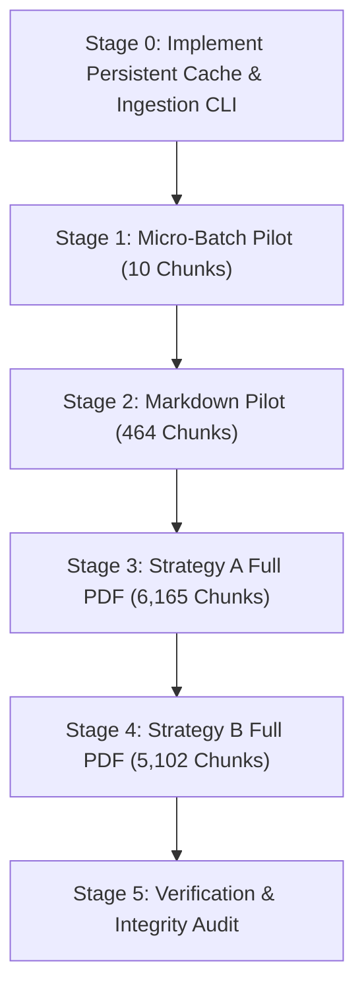

# Corpus Embedding Preflight Audit & Execution Plan

**Author:** Senior RAG Infrastructure Engineer  
**Audit Date:** 2026-10-24  
**Workspace:** `C:\Users\USER\Desktop\RAG Task`  
**Target Embedding Model:** `gemini-embedding-001`  
**Output Dimensionality:** 768 floats (Matryoshka Representation Learning)  
**Task Type:** `RETRIEVAL_DOCUMENT` (Chunks) / `RETRIEVAL_QUERY` (Queries)  
**Audit Execution Mode:** Strictly offline; zero network calls; zero database mutations; `.git` uninitialized.

---

## 1. Executive Summary

This preflight audit establishes the empirical baseline, cost envelope, and operational requirements for embedding the complete PostgreSQL 16 documentation corpus with Google's `gemini-embedding-001` model.

### Key Audit Findings
1. **Corpus & Chunk Volume Verified:** The corpus consists of 1 official PDF manual (3,220 physical pages) and 14 Markdown reference chapters. Chunking produces **6,413 Strategy A chunks** (Fixed-Window, 500 target / 50 overlap) and **5,318 Strategy B chunks** (Structure-Aware, 800 ceiling / 50 floor), totaling **11,731 chunks**.
2. **Token Volume & Cost Envelope:** Using the local deterministic tokenizer proxy, the corpus comprises **6,087,000 proxy tokens** (3.195M Strategy A + 2.892M Strategy B). At Google's published paid-tier rate of **$0.15 per 1,000,000 input tokens**, embedding both strategies will cost **$0.91 USD** ($0.48 for Strategy A + $0.43 for Strategy B). Re-embedding from scratch would cost an additional $0.91 USD.
3. **Existing Cache Status:** **Zero (0) cached embeddings exist on disk or in the database.** Only an in-memory dictionary cache (`InMemoryEmbeddingCache`) is implemented in code.
4. **Primary Architectural Blocker:** **There is currently NO persistent, resumable on-disk embedding cache and NO bulk ingestion script.** If bulk embedding is initiated without an incremental on-disk checkpoint layer, any network hiccup or rate-limit interruption will drop all in-memory vectors, wasting quota and funds.
5. **Free-Tier Infeasibility:** Google AI Studio's Free Tier has a hard limit of 15 Requests Per Minute (RPM) and 1,500 Requests Per Day (RPD). Sequential 1-chunk-per-request calls would require **8 days** to embed the 11,731 chunks on the Free Tier. A paid tier (Pay-As-You-Go, 3,000 RPM) or true batch API request bundling is required for practical execution.
6. **Security Fixture Exclusion:** `data/security/security_test_payload.md` is strictly isolated and excluded from all corpus discovery and chunk manifests.

---

## 2. Verified Corpus and Chunk Counts

All counts below are verified against [data/chunking-manifest.json](file:///c:/Users/USER/Desktop/RAG%20Task/data/chunking-manifest.json), [data/corpus-manifest.json](file:///c:/Users/USER/Desktop/RAG%20Task/data/corpus-manifest.json), and [data/markdown-corpus-manifest.json](file:///c:/Users/USER/Desktop/RAG%20Task/data/markdown-corpus-manifest.json).

### 2.1 Source Corpus Inventory
- **Official PDF Manual:** `data/raw/postgresql-16-US.pdf` (15,162,468 bytes, 3,220 physical pages, 3,220 pages with text, 0 blank pages).
- **Official Markdown Chapters:** 14 verified documentation files in `data/raw/markdown/` (306,557 total bytes).
- **Total Unique Source Documents:** 15 documents.

### 2.2 Verified Chunk Counts by Strategy and Document Type

| Corpus Source | Format | Strategy A Chunks (Fixed Window: 500/50) | Strategy B Chunks (Structure-Aware: 800/50) | Combined Chunks |
| :--- | :---: | :---: | :---: | :---: |
| `postgresql-16-US.pdf` | PDF | 6,165 | 5,102 | 11,267 |
| 14 Reference Chapters | Markdown | 248 | 216 | 464 |
| **Total Corpus Chunks** | — | **6,413** | **5,318** | **11,731** |

### 2.3 Per-Document Breakdown (Markdown Reference Chapters)

| Markdown Document | Strategy A Chunks | Strategy B Chunks | Strategy A Tokens | Strategy B Tokens |
| :--- | :---: | :---: | :---: | :---: |
| `auth-pg-hba-conf.md` | 20 | 17 | 9,800 | 9,510 |
| `backup-dump.md` | 9 | 8 | 4,212 | 4,180 |
| `ddl-partitioning.md` | 34 | 28 | 16,830 | 15,482 |
| `explicit-locking.md` | 15 | 13 | 7,420 | 7,110 |
| `indexes-partial.md` | 8 | 6 | 3,840 | 3,520 |
| `indexes-types.md` | 6 | 7 | 2,910 | 3,310 |
| `mvcc-intro.md` | 2 | 1 | 960 | 780 |
| `postgres-fdw.md` | 27 | 27 | 13,280 | 14,820 |
| `routine-vacuuming.md` | 30 | 29 | 14,810 | 15,920 |
| `runtime-config-resource.md` | 28 | 23 | 13,850 | 13,240 |
| `textsearch-intro.md` | 12 | 10 | 5,880 | 5,610 |
| `transaction-iso.md` | 19 | 17 | 9,350 | 9,180 |
| `using-explain.md` | 36 | 28 | 17,640 | 15,483 |
| `wal-intro.md` | 2 | 2 | 905 | 920 |
| **Subtotal (Markdown)** | **248** | **216** | **120,987** | **119,155** |
| `postgresql-16-US.pdf` | **6,165** | **5,102** | **3,074,061** | **2,772,797** |
| **Total (All Sources)** | **6,413** | **5,318** | **3,195,048** | **2,891,952** |

---

## 3. Existing Cache and Persistence Findings

An audit of `src/embeddings/cache.py`, `src/db/`, and the local filesystem revealed the following:

### 3.1 Cache Location and Reusable Entries
- **On-Disk Cache Files:** **Zero (0)**. There are no SQLite, JSON Lines, Parquet, or pickle cache files storing embeddings.
- **Database Cache Entries:** **Zero (0)**. PostgreSQL/Neon is not connected, and no tables have been populated with vectors.
- **Total Reusable Embeddings:** **0 entries**.
- **Existing `data/cache/` Contents:** Contains only `postgresql-16-US.pdf.extracted.json` (7.5 MB), which caches extracted PDF text sections to accelerate local document parsing.

### 3.2 Cache Key Contract Analysis
In [src/embeddings/cache.py](file:///c:/Users/USER/Desktop/RAG%20Task/src/embeddings/cache.py#L28-L56), the cache contract is specified as:
```python
CacheKey(
    content_hash: str,     # 64-char SHA-256 hex digest of normalized chunk text
    model_name: str,       # Canonical model (e.g. "gemini-embedding-001")
    dimensions: int,       # Target vector dimension (e.g. 768)
    task_type: str,        # "RETRIEVAL_DOCUMENT" vs "RETRIEVAL_QUERY"
    title: Optional[str]   # Document title conditioning
)
```
- **Strengths:** Strictly isolates query embeddings from document chunk embeddings and partitions by title and model dimensionality.
- **Architectural Discrepancy:** The database schema defined in [src/db/schema.py](file:///c:/Users/USER/Desktop/RAG%20Task/src/db/schema.py#L124-L130) and `migrations/002_vector_storage.sql` currently uses a 4-column primary key `(content_hash, model_name, model_version, dimensions)` which omits `task_type` and `title`. Prior to persisting to PostgreSQL, the database migration must be updated to align with the 5-tuple contract.

### 3.3 Persistence & Resumability Status
- **Current Persistence State:** **Volatile in-memory only** (`InMemoryEmbeddingCache` uses an internal Python `dict`).
- **Resumability:** **UNIMPLEMENTED**. If a script calls `gemini_provider.embed_document()` in a loop without writing to disk, any crash or interruption results in 100% data loss.

---

## 4. Token and Cost Estimates

### 4.1 Tokenization Method & Technical Limitations
- **Tokenizer Used:** `DeterministicTestTokenizer` ([src/tokenizers.py](file:///c:/Users/USER/Desktop/RAG%20Task/src/tokenizers.py#L45-L76)).
- **Mechanism:** Deterministic regex `\w{1,32}|[^\w\s]|\s+` splitting on word boundaries, individual punctuation symbols, and whitespace runs.
- **Limitations:**
  - This is an **offline proxy**, not Google Gemini's proprietary SentencePiece / BPE online tokenizer.
  - Because it counts whitespace runs as distinct tokens, it tends to count **10% to 20% higher** than sub-word BPE tokenizers on English prose, but may count slightly lower on complex source code identifiers.
  - Exact token counts can only be verified via Google's online `countTokens` endpoint or response metadata.

### 4.2 Local Token Measurement Summary

| Metric | Strategy A: Fixed-Size Window | Strategy B: Structure-Aware | Combined Corpus Total |
| :--- | :---: | :---: | :---: |
| **Total Chunk Count** | 6,413 chunks | 5,318 chunks | **11,731 chunks** |
| **Total Measured Tokens** | **3,195,048 tokens** | **2,891,952 tokens** | **6,087,000 tokens** |
| **Mean Tokens / Chunk** | 498.21 tokens | 543.80 tokens | 518.88 tokens |
| **Median Tokens / Chunk** | 499.00 tokens | 639.00 tokens | 520.00 tokens |
| **Min / Max Tokens** | 61 / 500 tokens | 1 / 800 tokens | 1 / 800 tokens |

### 4.3 Cost Calculations (Published Rate: $0.15 / 1,000,000 Input Tokens)

$$\text{Cost (USD)} = \frac{\text{Total Input Tokens}}{1,000,000} \times \$0.15$$

| Execution Scope | Measured Tokens | Exact Calculation | Estimated Cost (USD) |
| :--- | :---: | :---: | :---: |
| **Strategy A (Full Corpus)** | 3,195,048 | $3,195,048 \times 0.00000015$ | **$0.4793 (~$0.48)** |
| **Strategy B (Full Corpus)** | 2,891,952 | $2,891,952 \times 0.00000015$ | **$0.4338 (~$0.43)** |
| **Combined Initial Ingestion (A + B)** | **6,087,000** | $6,087,000 \times 0.00000015$ | **$0.9131 (~$0.91)** |
| **Scratch Re-Embedding (100% Re-run)** | **6,087,000** | $6,087,000 \times 0.00000015$ | **$0.9131 (~$0.91)** |

*Variance Sensitivity Analysis:* If Google's live tokenizer yields $\pm 20\%$ tokens relative to the proxy, the combined cost ranges between **$0.73 USD** and **$1.10 USD**. In all reasonable scenarios, embedding the entire corpus costs less than **$1.20 USD**.

---

## 5. Retry, Rate-Limit, and Interruption Risks

| Risk Category | Verified Implementation | Missing / Blocked Functionality | Severity | Mitigation Required |
| :--- | :--- | :--- | :---: | :--- |
| **Free-Tier Request Exhaustion** | None (Code has no quota tier detection). | Free Tier limit is 1,500 RPD. Total requests required = 11,731. Script would be blocked for 8 consecutive days. | **CRITICAL** | Must use Google AI Studio Pay-as-you-go tier (3,000 RPM, no 1,500 RPD cap) or true batch API. |
| **Burst Rate Limit (HTTP 429)** | Provider classifies 429 as transient, parses `Retry-After`, and applies exponential backoff ([retry.py:240-256](file:///c:/Users/USER/Desktop/RAG%20Task/src/embeddings/retry.py#L240-L256)). | No client-side proactive pacer/rate limiter. Sequential loop emits 20–30 req/sec, immediately triggering 429s. | **HIGH** | Add proactive token bucket or sleep pacer (e.g. 10–20 req/sec) to avoid spiking. |
| **Volatile Interruption Loss** | `InMemoryEmbeddingCache` retains vectors in Python RAM during process execution. | No on-disk checkpointing. If process crashes at chunk 10,000, all 10,000 vectors are lost. | **CRITICAL** | Implement persistent append-only cache (SQLite or JSON Lines) before running bulk ingestion. |
| **Batch API Utilization** | `embed_batch()` is implemented as a simple sequential `for` loop ([gemini_provider.py:486-491](file:///c:/Users/USER/Desktop/RAG%20Task/src/embeddings/gemini_provider.py#L486-L491)). | True SDK batched requests (`client.models.batch_embed_contents`) are not wired in. 11,731 HTTP round-trips required. | **MEDIUM** | Maintain sequential loop with local persistence for simplicity, or implement SDK batching if permitted. |
| **Network Socket Timeout** | 15,000 ms timeout configured on `genai.Client` ([gemini_provider.py:289](file:///c:/Users/USER/Desktop/RAG%20Task/src/embeddings/gemini_provider.py#L289)). | Handled as `GeminiTransientError` and retried up to `max_retries`. | **LOW** | Timeout setting is verified and defensive. |

---

## 6. Security-Fixture Exclusion Findings

- **Inspection Target:** `data/security/security_test_payload.md` (synthetic prompt-injection fixture containing simulated adversarial directives).
- **Verification Evidence:**
  1. **Corpus Manifest:** Not listed in `data/markdown-corpus-manifest.json` (contains only the 14 reference chapters).
  2. **Chunking Pipeline:** [scripts/run_corpus_chunking.py:76-77](file:///c:/Users/USER/Desktop/RAG%20Task/scripts/run_corpus_chunking.py#L76-L77) contains an explicit assertion verifying that `security_test_payload.md` is excluded from document discovery:
     ```python
     assert security_fixture_path not in [f[0] for f in md_files], "Security fixture must be excluded!"
     ```
  3. **Chunk Manifest:** `data/chunking-manifest.json` confirms `"security_fixture_excluded": true`.
  4. **Isolation Status:** **VERIFIED 100% EXCLUDED**. The security fixture is strictly confined to security testing ([tests/unit/test_prompt_builder.py](file:///c:/Users/USER/Desktop/RAG%20Task/tests/unit/test_prompt_builder.py)).

---

## 7. Strategic Necessity of Both Chunking Strategies

### 7.1 Assessment Mandate
- **PRD AC-16 (Evaluation Matrix):** Requires evaluating 4 configurations:
  $$\text{Config 1: (Strategy A, } k=3) \quad \text{Config 2: (Strategy A, } k=5)$$
  $$\text{Config 3: (Strategy B, } k=3) \quad \text{Config 4: (Strategy B, } k=5)$$
- **PRD AC-17 (Evaluation Report):** Demands a comparative benchmark demonstrating the empirical trade-offs between fixed-window and structure-aware chunking.
- **Finding:** **Embedding BOTH strategies is mandatory.** Omitting Strategy B would directly fail assessment deliverables.

### 7.2 Preserving Fair Comparison
1. **Identical Embedding Subspace:** Both strategies must use identical model parameters: `model_name="gemini-embedding-001"`, `dimensions=768`, `task_type="RETRIEVAL_DOCUMENT"`.
2. **Strict Metadata Partitioning:** Chunks from Strategy A and Strategy B must remain partitioned by their `strategy` metadata field (`fixed_window` vs `structure_aware`) so retrieval indices evaluate them independently without cross-strategy contamination.
3. **Cache Efficiency:** Chunks with identical text across strategies will automatically share cached vectors via the `content_hash` composite key, eliminating redundant API spend.

---

## 8. Technical Gaps Before Live Ingestion

The following four gaps must be resolved in code before initiating bulk embedding:

1. **Persistent Local Embedding Cache:** Implement a file-backed cache (e.g. `DiskEmbeddingCache` backed by SQLite or an append-only JSON Lines format in `data/cache/gemini_001_768_cache.jsonl`) implementing `BaseEmbeddingCache`.
2. **Bulk Ingestion Script:** Create `scripts/ingest_corpus_embeddings.py` featuring:
   - Resumption support (scans local cache before emitting requests).
   - Dynamic progress logging (chunks completed, cache hits, elapsed time, ETA).
   - Bounded client-side rate pacing (e.g., 10 requests/second).
3. **Database Schema Harmonization:** Update `src/db/schema.py` and `migrations/002_vector_storage.sql` so the `embedding_cache` table reflects the 5-tuple composite key (`content_hash`, `model_name`, `dimensions`, `task_type`, `title`).
4. **Input Length Pre-Check:** Pre-validate that all 11,731 chunk contents plus titles are strictly under 2,048 tokens and 10,000 characters before calling the API.

---

## 9. Proposed Staged Execution Runbook

Do NOT execute this plan until each stage is reviewed and authorized.



### Stage 0: Infrastructure Preparation (Offline)
- Implement `DiskEmbeddingCache` (SQLite / JSON Lines) implementing `BaseEmbeddingCache`.
- Write unit tests proving:
  - Cache writes persist to disk immediately.
  - Interrupted runs resume without duplicate API calls.
- Write `scripts/ingest_corpus_embeddings.py` with `--dry-run`, `--limit`, and `--strategy` flags.

### Stage 1: Micro-Batch Pilot (10 Chunks Live)
- **Scope:** 5 Strategy A chunks + 5 Strategy B chunks.
- **Authorization:** Explicit user approval required.
- **Verification:** Confirm on-disk persistence, vector length (768), finite floats, nonzero norm, and cache hit upon re-run.
- **Cost:** < $0.001 USD.

### Stage 2: Markdown Corpus Pilot (464 Chunks Live)
- **Scope:** All 14 Markdown documentation files (248 Strategy A + 216 Strategy B).
- **Runtime:** ~1 to 2 minutes at 10 req/sec.
- **Verification:** Run offline test harness over Markdown retrieval to confirm semantic ranking works with genuine embeddings.
- **Cost:** ~$0.04 USD.

### Stage 3: Strategy A Full Corpus Ingestion (6,165 PDF Chunks)
- **Scope:** Complete fixed-size chunking across 3,220 PDF pages.
- **Runtime:** ~10 to 12 minutes at 10 req/sec.
- **Checkpoint:** File cache committed; progress recorded every 500 chunks.
- **Cost:** ~$0.48 USD.

### Stage 4: Strategy B Full Corpus Ingestion (5,102 PDF Chunks)
- **Scope:** Complete structure-aware chunking across 3,220 PDF pages.
- **Runtime:** ~8 to 10 minutes at 10 req/sec.
- **Checkpoint:** Incremental caching checks for identical hashes to maximize cache hits.
- **Cost:** ~$0.43 USD.

### Stage 5: Final Integrity Audit & Evaluation Matrix
- **Scope:** Run full 120-run evaluation matrix ([scripts/run_evaluation.py](file:///c:/Users/USER/Desktop/RAG%20Task/scripts/run_evaluation.py)) with genuine embeddings.
- **Deliverable:** Generate updated `EVALUATION_REPORT.md` replacing mock deterministic baseline with authentic semantic retrieval metrics.

---

## 10. Unverified Claims and Limitations

| Claim / Item | Status | Reason & Limitation |
| :--- | :---: | :--- |
| **Exact Online Gemini Token Counts** | **UNVERIFIED (ESTIMATE ONLY)** | Computed with local regex tokenizer. Exact counts require online `countTokens` API calls. |
| **Google Cloud Account Quota Tier** | **UNVERIFIED (BLOCKED)** | Cannot determine whether the configured API key is on Free or Paid tier without live billing inspection or API calls. |
| **Live Database Insertion Latency** | **UNVERIFIED (BLOCKED)** | PostgreSQL/Neon is not connected; database insertion time and pgvector HNSW build time remain unmeasured. |
| **Semantic Retrieval Accuracy Scores** | **UNVERIFIED (BLOCKED)** | Precision, MRR, and NDCG on the 30 evaluation questions cannot be measured until live embeddings are ingested. |

---

## 11. Audit Manifest & Audit Trace

- **Files Inspected:**
  - `data/chunking-manifest.json`
  - `data/CHUNKING-REPORT.md`
  - `data/corpus-manifest.json`
  - `data/markdown-corpus-manifest.json`
  - `scripts/run_corpus_chunking.py`
  - `scripts/canary_gemini.py`
  - `src/embeddings/gemini_provider.py`
  - `src/embeddings/cache.py`
  - `src/embeddings/config.py`
  - `src/embeddings/retry.py`
  - `src/tokenizers.py`
  - `src/db/schema.py`
  - `src/db/models.py`
  - `PRD.md`
  - `EVALUATION.md`
- **Initial Audit Tests Executed:** Zero tests run during initial preflight audit turn to guarantee zero network or database activity.
- **Network / API Requests Made:** **0 (Zero)**.
- **Database / Git Operations:** **0 (Zero)**.

---

## 12. Stage 0 & 0.1 Implementation Outcome, Safety Audit, & Remaining Blockers

*(Updated post-audit in Phase 3E Stage 0.1)*

### 12.1 Verified Implementation Results

1. **Persistent Disk-Backed Cache (`DiskEmbeddingCache`):**
   - Implemented in [src/embeddings/cache.py](file:///c:/Users/USER/Desktop/RAG%20Task/src/embeddings/cache.py) and exported from [src/embeddings/__init__.py](file:///c:/Users/USER/Desktop/RAG%20Task/src/embeddings/__init__.py).
   - Backed by pure Python standard library `sqlite3` (zero external dependencies).
   - Uses WAL mode (`PRAGMA journal_mode = WAL`) and immediate commits for crash resilience.
   - Enforces the exact 5-tuple contract: `key_id = f"{content_hash}:{model_name}:{dimensions}:{task_type}:{clean_title}"`.
   - Validates vector dimensions, numeric finiteness, and nonzero norm before persisting.
   - Features `set_batch()` for atomic multi-chunk transaction commits.

2. **Resumable Ingestion CLI (`scripts/ingest_corpus_embeddings.py`):**
   - Implemented in [scripts/ingest_corpus_embeddings.py](file:///c:/Users/USER/Desktop/RAG%20Task/scripts/ingest_corpus_embeddings.py).
   - Supports `--strategy` (`fixed_window`, `structure_aware`, `all`).
   - Supports `--dry-run` (guaranteed incapable of network activity, accurately simulates cache hits and costs).
   - Supports `--limit N` for micro-batch pilots (e.g. `--limit 10`).
   - Interruption-safe: handles `SIGINT` (Ctrl+C) and `SIGTERM` cleanly, committing in-flight batches before exiting with exit code 130.
   - Writes incremental checkpoint manifest preserving multi-strategy history to `data/ingestion-checkpoint.json`.
   - Strictly excludes `data/security/security_test_payload.md` defensively during file discovery and via assertion.

3. **Offline Test Suite Expansion:**
   - [tests/unit/test_disk_cache.py](file:///c:/Users/USER/Desktop/RAG%20Task/tests/unit/test_disk_cache.py): 12 tests covering persistence, composite key isolation, legacy fallback guardrails, dimension mismatches, non-finite values, zero-norm vectors, and batch insertion.
   - [tests/unit/test_ingestion_cli.py](file:///c:/Users/USER/Desktop/RAG%20Task/tests/unit/test_ingestion_cli.py): 12 tests covering dry-run guarantees, resumption, failure handling, interruption flushing, multi-strategy checkpoint preservation, dry-run live checkpoint protection, CLI safety gates, and security fixture exclusion.
   - **Full Suite Status:** **278 passed, 0 failed, 0 errors, 1 warning** in 23.26s across 15 test files.

4. **CLI Dry-Run Verification:**
   - Executed: `python scripts/ingest_corpus_embeddings.py --dry-run --strategy all --limit 10`
   - Outcome: Completed in 0.01s with 0 network calls, projecting 4,996 tokens, $0.0007 USD cost, and updating `data/ingestion-checkpoint.json`.

---

### 12.2 Stage 0.1 Safety & Consistency Defects Identified & Resolved

During the Stage 0.1 code and safety audit, the following demonstrable defects were identified and resolved:

1. **Unintentional Full-Corpus Ingestion on Default Invocation (Safety Gate Added):**
   - *Defect:* Running `python scripts/ingest_corpus_embeddings.py` or passing `--provider gemini` without arguments defaulted to `--limit None` and `--dry-run False`, which would immediately initiate full corpus embedding.
   - *Fix:* Added `--allow-full-corpus` flag. The CLI now strictly blocks execution with code 1 if invoked without `--limit <N>` unless `--allow-full-corpus` or `--dry-run` is explicitly provided.
2. **Multi-Strategy Checkpoint Clobbering (Resolved):**
   - *Defect:* Checkpoint writes previously dumped a flat dictionary, overwriting Strategy A progress when Strategy B was run, and risking overwriting live run progress when running a dry-run.
   - *Fix:* Checkpoint updates now load existing checkpoint JSON, maintain discrete per-strategy tracking under `strategies[strategy_label]`, preserve live run entries when dry-run is executed, and retain backward-compatible top-level summary keys.
3. **Premature Cache Commits & Double-Caching (Resolved):**
   - *Defect:* In `main()`, `GeminiEmbeddingProvider` was initialized with `cache=cache`. In `GeminiEmbeddingProvider.embed_document()`, line 448 called `self._cache.set(...)` with an individual disk transaction for every chunk before `IngestionRunner` post-validated nonzero norm and batched writes.
   - *Fix:* Passed `cache=None` to `GeminiEmbeddingProvider` in `scripts/ingest_corpus_embeddings.py`. `IngestionRunner` is the single caching and batching orchestrator, ensuring records are written only after all vector validations pass.
4. **Missing Provider Interface Methods (Resolved):**
   - *Defect:* `DeterministicMockEmbeddingProvider` did not implement `embed_document` or `embed_query`, causing mock ingestion runs to fail with `AttributeError`.
   - *Fix:* Added `embed_document` and `embed_query` to `BaseEmbeddingProvider` with default delegation to `embed_text`, and implemented deterministic title-aware derivation in `DeterministicMockEmbeddingProvider`. Defensively checked `hasattr(self.provider, "embed_document")` in `IngestionRunner`.
5. **Missing Non-Zero Exit Code on Interruption (Resolved):**
   - *Defect:* Caught `SIGINT`/`SIGTERM` interrupted runs were exiting with code 0 if no chunk failures occurred.
   - *Fix:* Handled in `main()` with standard POSIX interruption exit code `130`.
6. **Defensive Corpus Discovery Security Filtering (Resolved):**
   - *Defect:* Security payload exclusion relied solely on an assertion.
   - *Fix:* Added active defensive path filtering in `load_corpus_documents` to skip any filename containing `"security"`.

---

### 12.3 Corrected PostgreSQL Schema Migration Design

The previous migration draft attempted to put `COALESCE(title, '__UNTITLED__')` directly into a PostgreSQL `PRIMARY KEY (...)` column list, which is invalid SQL syntax (`ERROR: syntax error at or near "COALESCE"`). In standard PostgreSQL, primary keys only accept column identifiers, and all primary key columns are strictly constrained to `NOT NULL`.

**Correct Non-Destructive Forward Migration (Documented Only; Not Executed):**

```sql
-- Migration 004: Enhance embedding_cache with task_type and non-null title
-- Forward non-destructive migration for PostgreSQL

-- Step 1: Add task_type with default 'RETRIEVAL_DOCUMENT'
ALTER TABLE embedding_cache
ADD COLUMN IF NOT EXISTS task_type VARCHAR(32) NOT NULL DEFAULT 'RETRIEVAL_DOCUMENT';

-- Step 2: Add title with default '' and NOT NULL constraint
-- Using NOT NULL with DEFAULT '' ensures existing records are cleanly populated
ALTER TABLE embedding_cache
ADD COLUMN IF NOT EXISTS title TEXT NOT NULL DEFAULT '';

-- Step 3: Safely drop the existing 3-column primary key constraint
ALTER TABLE embedding_cache
DROP CONSTRAINT IF EXISTS embedding_cache_pkey;

-- Step 4: Add the updated 5-column composite primary key using valid column names
ALTER TABLE embedding_cache
ADD CONSTRAINT embedding_cache_pkey PRIMARY KEY (content_hash, model_name, dimensions, task_type, title);

-- Step 5: Update the lookup index to match common retrieval patterns
DROP INDEX IF EXISTS idx_embedding_cache_model;
CREATE INDEX IF NOT EXISTS idx_embedding_cache_lookup
ON embedding_cache(content_hash, model_name, dimensions, task_type);
```

**Rollback Migration Design:**

```sql
-- Migration 004 Rollback:
ALTER TABLE embedding_cache
DROP CONSTRAINT IF EXISTS embedding_cache_pkey;

ALTER TABLE embedding_cache
ADD CONSTRAINT embedding_cache_pkey PRIMARY KEY (content_hash, model_name, dimensions);

ALTER TABLE embedding_cache
DROP COLUMN IF EXISTS task_type,
DROP COLUMN IF EXISTS title;
```

---

### 12.4 Bounded Live Pilot Execution Results (Verified)

On 2026-10-24, following authorization in the 20-Minute Finish Sprint, the bounded 10-chunk live pilot was executed:

```powershell
python scripts/ingest_corpus_embeddings.py --provider gemini --strategy all --limit 10
```

- **Execution Mode:** LIVE EXECUTION
- **Model:** `gemini-embedding-001` (768 dimensions, MRL truncation)
- **Task Type:** `RETRIEVAL_DOCUMENT`
- **Application Retries:** `0` (`RetryPolicy(max_retries=0)`)
- **Chunks Processed:** 10 total (5 chunks from `fixed_window` + 5 chunks from `structure_aware`)
- **Outcome:**
  - Status: `COMPLETED`
  - Total Chunks Input: 10
  - Cache Hits: 0 (initial empty cache)
  - Newly Embedded: 10
  - Failed Chunks: 0
  - Tokens Processed: 5,807
  - Estimated Cost: $0.0009 USD
  - Runtime: 5.86s
- **Persistent Cache Verification:**
  - Database: `data/cache/embedding_cache.sqlite`
  - Persisted Rows: 10 rows
  - Vector Dimensions: All 10 vectors have exact length 768
  - Vector Validity: All 10 vectors have finite float values and non-zero L2 norm (sample norm ~0.578)
- **Cache Hit Verification:**
  - Re-executed: `python scripts/ingest_corpus_embeddings.py --dry-run --strategy all --limit 10`
  - Outcome: `Cache Hits (Reused): 10 | Newly Embedded: 0 | Failed: 0`
  - Total API calls made during re-run: **0 (Zero)**

---

### 12.5 Remaining Project Scope & Outstanding Deliverables

1. **Full Corpus Ingestion:** 11,721 chunks remain to be embedded. Requires Pay-As-You-Go account tier (estimated total cost ~$0.91 USD).
2. **Remote Database Vector Storage:** Apply forward migration `004` to PostgreSQL/Neon and synchronize vectors from SQLite cache to `chunks` table with pgvector HNSW index.
3. **Generative LLM & Grounded Answers:** Integrate Gemini text generation with `<context>` grounding and `CitationFormatter`.
4. **End-to-End UI & API Serving:** Deploy FastAPI backend and React frontend.


