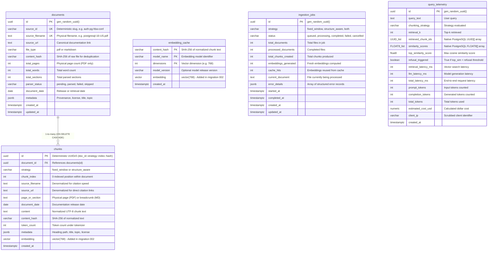

# Database Schema & Migration Guide: PostgreSQL + pgvector

**Location:** `migrations/`  
**Target Database:** PostgreSQL 15+ with `pgvector` extension  
**Application:** PostgreSQL Documentation Assistant (RAG System)  
**Author:** Senior Backend Engineer  

---

## 1. Schema Overview & Entity Relationship Diagram

The persistence layer is structured around four primary entities and one observability entity, supporting asynchronous document ingestion, dual-strategy chunking, content-hash deduplication, embedding caching, and vector similarity retrieval:



> **Native Array Types (REQ-13):**  
> `query_telemetry.retrieved_chunk_ids` uses native PostgreSQL 1-D array `UUID[]` (internal catalog type `_uuid`), and `similarity_scores` uses native `FLOAT8[]` (`_float8` / `DOUBLE PRECISION[]`). No custom composite or domain types (such as `uuid_array` or `float_array`) exist or are required in PostgreSQL. The DDL defines `UUID[] NOT NULL DEFAULT '{}'` and `FLOAT8[] NOT NULL DEFAULT '{}'`.

---

## 2. Migration Files & Execution Sequence

Migrations are strictly sequential, versioned with 3-digit prefixes, and accompanied by fully symmetric rollback scripts:

| Migration File | Rollback File | Description & Scope |
| :--- | :--- | :--- |
| `001_create_core_tables.sql` | `001_create_core_tables.rollback.sql` | Creates standard relational tables (`ingestion_jobs`, `documents`, `chunks`, `embedding_cache`) and B-tree/GIN indexes. Does not require `pgvector`. |
| `002_vector_storage.sql` | `002_vector_storage.rollback.sql` | Enables `vector` extension, adds `embedding` vector column to `chunks` and `embedding_cache`, and builds the HNSW cosine index. |
| `003_telemetry_schema.sql` | `003_telemetry_schema.rollback.sql` | Creates `query_telemetry` table and indexes for audit logging, latency tracking, and cost calculation (REQ-13). |

### Why Decouple Core Tables (001) from Vector Storage (002)?
1. **Host Portability**: `001_create_core_tables.sql` can run and be validated on any standard PostgreSQL instance, container, or CI environment even before the native C-extension `pgvector` is compiled or installed.
2. **Dimension Flexibility**: Vector dimensions can be adjusted or verified before executing migration 002.
3. **Clean Failure Isolation**: If a deployment environment lacks pgvector binary support, relational schema initialization still succeeds cleanly with explicit diagnostics.

---

## 3. Key Schema Design Decisions & Constraints

### 3.1 Dual-Strategy Coexistence & Chunk Idempotency
- **No Overwriting Between Strategies**:
  `chunks` enforces a composite unique constraint:
  ```sql
  CONSTRAINT uq_chunks_doc_strat_index UNIQUE (document_id, strategy, chunk_index)
  ```
  This allows Strategy A (`fixed_window`, chunks $0 \dots 6,412$) and Strategy B (`structure_aware`, chunks $0 \dots 5,317$) to reside concurrently in the database for the same documents without ID collision or overwriting.
- **Deterministic Chunk IDs & Document Provenance**:
  Chunk `id` is a primary key UUIDv5 generated deterministically via:
  `uuid5(NAMESPACE_RAG_CHUNK, f"{doc_id}::{strategy}::{chunk_index}::{content_hash}")`
  Re-chunking an identical document generates byte-for-byte identical UUIDs.
- **Document Identity Design Trade-Off**:
  - `documents.source_id`: Unique logical identifier (e.g., `'postgresql-16-US'`, `'auth-pg-hba-conf'`).
  - `documents.source_filename`: Unique physical filename. In the current corpus, all 15 source files have globally unique filenames. If future corpora introduce nested subdirectories with identical filenames (e.g. `ch1/intro.md` and `ch2/intro.md`), the schema should transition to relative source paths (`source_path UNIQUE`).
  - `documents.id`: A UUID primary key. To maintain 100% deterministic reproducibility across database migrations and rebuilds, the ingestion pipeline derives `documents.id` deterministically via `uuid5(NAMESPACE_RAG_CHUNK, source_id)`.

### 3.2 Safe Re-Ingestion & Deduplication Policy: Atomic DELETE + INSERT vs. UPSERT
- **Unmodified Document Bypass**:
  Before parsing, the pipeline calculates the source file's SHA-256 hash. If `documents.content_hash` matches, the entire ingestion job skips the file with zero database writes and zero API calls.
- **Why Atomic DELETE + INSERT is Required (The "Zombie Chunk" Risk of UPSERT)**:
  If a modified document is re-ingested, an `INSERT ... ON CONFLICT (document_id, strategy, chunk_index) DO UPDATE` approach introduces severe failure modes:
  1. *Orphaned Zombie Chunks*: If revision 1 produced 25 chunks, and revision 2 produces only 18 chunks, an UPSERT only updates chunks $0 \dots 17$, leaving chunks $18 \dots 24$ permanently in the database as stale, orphaned zombie chunks.
  2. *Primary Key Collision*: Because chunk `id` is a deterministic hash of content, updating an existing chunk index with new content alters the primary key `id`, which standard SQL `DO UPDATE` clauses cannot safely perform across foreign keys.
  3. *Proven Transactional Replacement*:
     ```sql
     BEGIN;
     -- Atomic deletion of stale chunks for this specific document and strategy only
     DELETE FROM chunks WHERE document_id = :doc_id AND strategy = :strategy;
     -- Update document content hash and modification timestamp
     UPDATE documents SET content_hash = :new_hash, updated_at = CURRENT_TIMESTAMP WHERE id = :doc_id;
     -- Insert fresh, validated chunks
     INSERT INTO chunks (id, document_id, strategy, chunk_index, ...) VALUES (...);
     COMMIT;
     ```
     `ON DELETE CASCADE` ensures that deleting a document record cleanly purges all its chunks for both strategies.

### 3.3 Embedding Cache Isolation & Invariants
- `embedding_cache` uses a composite primary key:
  ```sql
  PRIMARY KEY (content_hash, model_name, dimensions)
  ```
  This ensures:
  1. If text content changes $\to$ `content_hash` changes $\to$ fresh vector is computed and stored.
  2. If the embedding model changes $\to$ `model_name` changes $\to$ entries do not collide or return corrupt vectors.
  3. If dimension truncation (MRL) is configured $\to$ `dimensions` changes $\to$ entries remain distinct.
- **Model Identity Invariant**:
  `model_name` must always store the **canonical fully-qualified model identifier** (e.g. `'text-embedding-004'` or `'models/text-embedding-004'`). Because `model_version` is an optional descriptive column, encoding the generation in `model_name` guarantees that successive model generations never collide even if their dimensions are identical.

### 3.4 Vector Dimension Decision, Parameterization & pgvector Bounds
- **Provisional Model & Dimension Status**:
  Google Gemini `text-embedding-004` and **768 dimensions** are **provisional defaults** adopted in [ARCHITECTURE.md](file:///c:/Users/USER/Desktop/RAG%20Task/ARCHITECTURE.md). They must be verified against live Google AI Studio documentation and quotas in Phase 3E before any API calls are executed. The schema must not assume this default is permanent.
- **Strict Validation Bounds (1 to 2,000 Dimensions)**:
  `migrations/002_vector_storage.sql` uses a marked parameter token `vector(/* __EMBEDDING_DIM__ */ 768)`. The migration runner [`src/db/migrator.py`](file:///c:/Users/USER/Desktop/RAG%20Task/src/db/migrator.py) validates that `--dim` is strictly an integer within pgvector's indexing range:
  $$1 \le \text{dimension} \le 2000$$
  *(pgvector strictly rejects dimensions $> 2000$ when constructing HNSW indexes with `vector_cosine_ops`).*
- **Migration-Safe Alter Path**:
  If an alternative model is selected before Phase 3E (e.g. OpenAI `text-embedding-3-small` with 1536 dim, or HuggingFace `all-MiniLM-L6-v2` with 384 dim), the schema is updated safely without dropping tables:
  ```sql
  -- Safe ALTER migration for dimension change:
  DROP INDEX IF EXISTS idx_chunks_embedding_hnsw_cosine;
  ALTER TABLE chunks ALTER COLUMN embedding TYPE vector(NEW_DIM);
  ALTER TABLE embedding_cache ALTER COLUMN embedding TYPE vector(NEW_DIM);
  CREATE INDEX idx_chunks_embedding_hnsw_cosine ON chunks 
  USING hnsw (embedding vector_cosine_ops) WITH (m = 16, ef_construction = 64);
  ```

---

## 4. HNSW Vector Indexing & Distance Metric

### Distance Metric Alignment
- Operator: `<=>` (Cosine Distance) with operator class `vector_cosine_ops`.
- Mathematical relationship to retrieval similarity score $s \in [0.0, 1.0]$:
  $$\text{cosine\_distance}(u, v) = 1 - \frac{u \cdot v}{\|u\|_2 \|v\|_2}$$
  $$\text{similarity\_score}(u, v) = 1 - \text{cosine\_distance}(u, v)$$
- Retrieval SQL query:
  ```sql
  SELECT id, document_id, page_or_section, content, 
         1 - (embedding <=> :query_vector) AS similarity_score
  FROM chunks
  WHERE strategy = :target_strategy
  ORDER BY embedding <=> :query_vector ASC
  LIMIT :k;
  ```
  This query directly leverages the HNSW index on `chunks(embedding vector_cosine_ops)`.

### Why HNSW over IVFFlat?
1. **No Training Step**: IVFFlat requires an initial $K$-means clustering pass over populated data. If run on an empty table or small initial batch, IVFFlat suffers from severely degraded recall.
2. **Incremental Insertions**: HNSW supports continuous, incremental insertions during background ingestion without index degradation.
3. **High Recall & QPS**: At 768 dimensions, HNSW consistently achieves $> 98\%$ recall with single-digit millisecond query latency.
4. **Tuned Hyperparameters**:
   - `m = 16`: Number of bidirectional links per graph node (standard default balancing memory and recall).
   - `ef_construction = 64`: Size of candidate evaluation list during construction.
   - At query time, `SET LOCAL hnsw.ef_search = 40;` can be configured for sub-millisecond retrieval with high recall.

---

## 5. Local Database Discovery & Verification Status

During Phase 3D environment inspection:
- **Service Detected**: `postgresql-x64-17` service is installed and **Running** on `localhost:5432`.
- **Authorization & Safety**: In accordance with `AGENTS.md` and user instructions, **no live database operations, connections, or migrations have been executed**.
- **pgvector Availability**: Unverified on the local PostgreSQL 17 service. (Windows PostgreSQL 17 does not bundle pgvector by default unless compiled or installed via Stack Builder / binary release).
- **Verification Mode**: All migration syntax, ordering, constraint integrity, and rollback symmetry are verified via automated offline static analysis tests (`tests/unit/test_migrations.py`).
